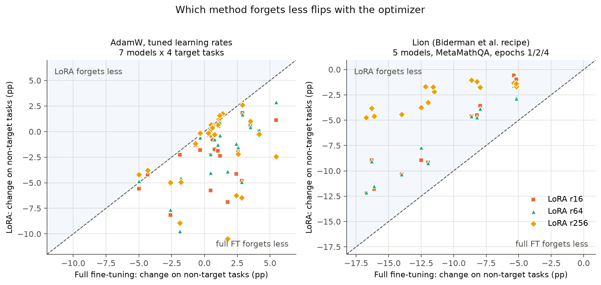
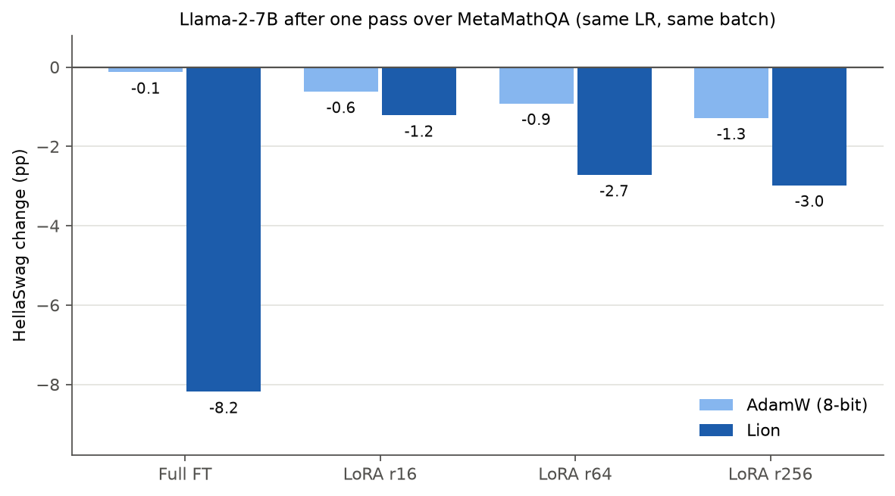
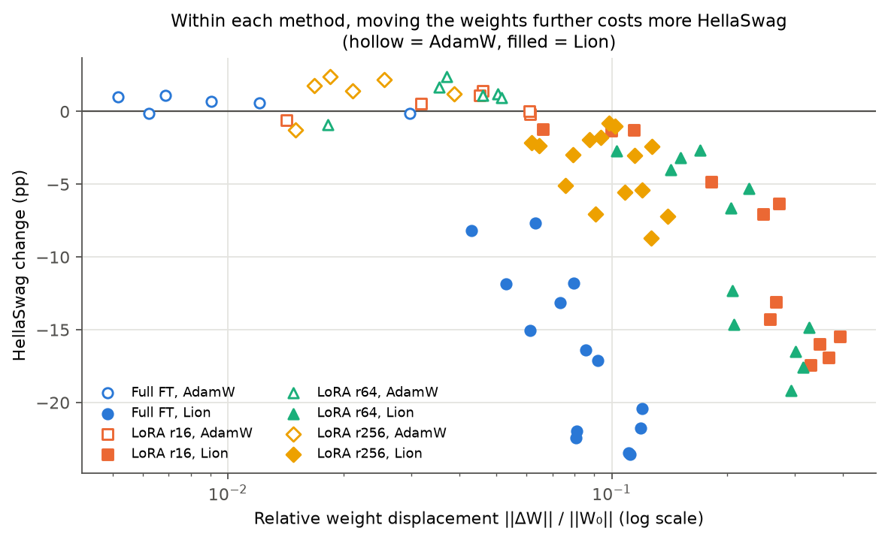
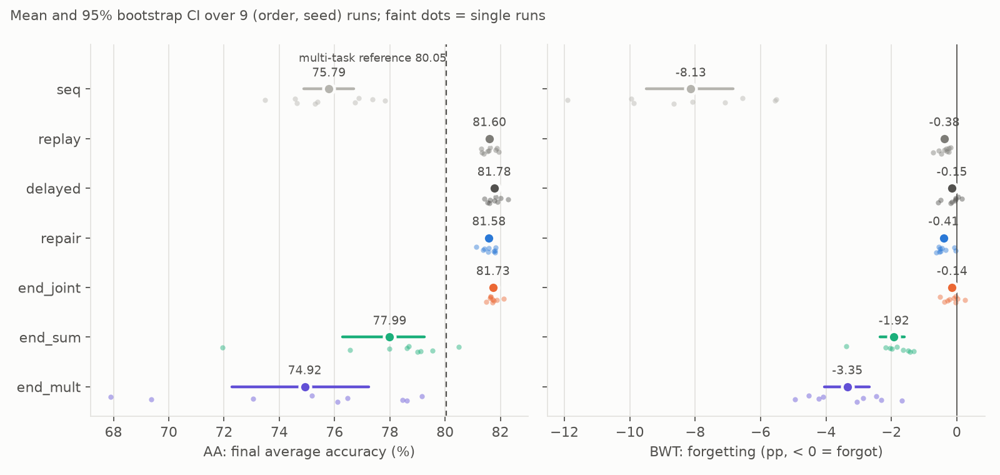

# Forgetting in LoRA Fine-Tuning

Fine-tuning a language model on a new task usually costs it something elsewhere. This repository
holds two studies of that **forgetting** in parameter-efficient (LoRA) fine-tuning:

1. **[LoRA vs full fine-tuning](#1-does-lora-forget-less-than-full-fine-tuning)**: does LoRA really
   forget less? Across 8 models (1B–7B) and two training regimes, the answer **flips with the optimizer**.
2. **[Continual learning with LoRA](#2-protecting-old-tasks-in-continual-learning)**: when a model
   learns four tasks one after another, can a small "repair" adapter undo the forgetting? It matches the
   strongest baselines, and the analysis shows *why*: the protection comes from distilling a tiny memory
   of old outputs, not from the adapter.

---

## 1. Does LoRA forget less than full fine-tuning?

### Motivation

[Biderman et al. (2024), *LoRA Learns Less and Forgets Less*](#references) found that LoRA learns a target
domain more slowly than full fine-tuning but preserves the base model's other abilities better. This study
asks whether that holds as a general property of LoRA. Its starting point was the observation that
their recipe uses the **Lion** optimizer, while most fine-tuning uses **AdamW**.

### Setup

| | Round robin | MetaMathQA |
|---|---|---|
| Models | Llama-3.2-1B/3B, Qwen2.5-1.5B/3B, Pythia-1.4B/2.8B, SmolLM3-3B, Llama-2-7B | Llama-2-7B, Llama-3.2-1B/3B, Qwen2.5-1.5B/3B |
| Target tasks | GSM8K, TriviaQA, HellaSwag, ARC-Easy (each model trained on each, in turn) | MetaMathQA (scored on GSM8K) |
| Optimizer | AdamW, learning rate tuned per task and method | **Lion** (Biderman et al. recipe), plus a 1-epoch AdamW run on Llama-2-7B |
| Methods | Full fine-tuning; LoRA rank 16 / 64 / 256 on all attention and MLP projections (α = 2r) | same |
| Forgetting measured on | the other three round-robin tasks | HellaSwag, ARC-Challenge, WinoGrande |

All evaluation used [lm-evaluation-harness](#references). *Learning* is the gain on the target task
and *forgetting* is the mean change on the non-target tasks, both in percentage points (pp).

### Result: the answer depends on the optimizer

| Regime | Full FT forgets less | Tie (< 1 pp) | LoRA forgets less | At matched learning (≤ 2 pp apart) |
|---|---:|---:|---:|---|
| AdamW, tuned LRs (7 models × 4 targets) | **47** | 37 | **0** | full FT 24 · tie 31 · LoRA 0 |
| AdamW, one LR per method | 65 | 18 | 1 | |
| **Lion**, MetaMathQA (5 models × 3 epochs) | **0** | 0 | **39** | LoRA 21 · tie 0 · full FT 0 |



With AdamW, LoRA **never** forgot less than full fine-tuning. With Lion, it forgot less in **every**
comparison, including all 21 pairs where both methods learned the same amount. Under Lion this
reproduces Biderman et al.'s results, including "higher rank forgets more". Under AdamW they reverse.

The cleanest contrast holds the model (Llama-2-7B), data (one pass over MetaMathQA), learning rate and
batch size fixed. Full fine-tuning's HellaSwag drop grows **60×** under Lion, while LoRA's barely moves:



### Why: Lion moves every weight, every step

- **AdamW** scales each weight's step by how consistent its gradient is. Weights the task doesn't need
  (noisy gradients that average to zero) barely move, so full fine-tuning makes a small, targeted update.
- **[Lion](#references)** moves *every* weight by exactly the learning rate each step, in the direction of
  `sign(momentum)`, however weak the signal. For full fine-tuning that means billions of weights
  random-walking away from their pretrained values.
- **LoRA** confines its update to *r* directions per matrix, so the rest of the network stays put
  whichever optimizer is used.

The measured weight displacement agrees. At the same learning rate, Lion moved Llama-2-7B's full fine-tuning
weights about **7× further** than AdamW, spread over about 60 directions per matrix. Within each method,
how far the weights moved predicts HellaSwag damage (Spearman ρ = −0.73 to −0.93):



Size alone is not the whole story. LoRA under Lion can move its weights *further* than full fine-tuning
and still forget less, because its change is concentrated in a few directions. Full fine-tuning's change is diffuse.

### Findings that hold in every regime

- At the same learning rate, **higher LoRA rank forgets more** (30 cases vs 3).
- Raising the learning rate past the optimum **buys forgetting, not learning** (17 vs 1).
- **Forgetting happens early**: it is essentially complete after the first epoch.
- The forgotten test items are a **shared pool of fragile examples** (8–60× more overlap than chance),
  whichever method is used.
- Full fine-tuning never creates **intruder dimensions** ([Shuttleworth et al.](#references)). LoRA under
  Lion creates hundreds, yet still forgets less, so intruder count is not a general predictor of forgetting.

**Limitations.** Every configuration is a single seed. Lion is confounded with the training text format
and schedule in the cleanest contrast. The decisive optimizer × format experiment is designed but not
yet run. Qwen2.5-3B LoRA r16/r64 diverged under Lion and are excluded. The full analysis, with hypotheses
and proposed follow-up experiments, is in [`finetuning_forgetting/FINDINGS.md`](finetuning_forgetting/FINDINGS.md).

---

## 2. Protecting old tasks in continual learning

### Setup

- **Model:** Llama-3.2-1B, with LoRA on all 7 linear layers.
- **Benchmark:** the 4-task text-classification sequence used by [O-LoRA](#references): DBpedia, Amazon,
  Yahoo Answers, AG News ([Zhang et al., 2015](#references)), in 3 task orders × 3 seeds = 9 runs per method.
- **Generative benchmark:** four generative tasks (GSM8K, TriviaQA, HellaSwag, WMT14 en→de), 5k training
  examples each, same 3 orders × 3 seeds.
- **Metrics:** AA = final average accuracy; BWT = backward transfer (forgetting; 0 = none).

**Repair** trains a rank-8 *learner* adapter on each new task, then a separate *repair* adapter that
restores the model's recorded outputs on a small memory of **128 stored examples per old task**. The best
variant applies **one joint repair after the last task**, protecting all tasks at once.

### Result

| Method | Memory | AA | BWT |
|---|---|---:|---:|
| Sequential LoRA (no protection) | none | 75.79 | −8.13 |
| O-LoRA ([Wang et al., 2023](#references)) | none | 79.75 | −2.47 |
| Replay | 128 / task | 81.60 | −0.38 |
| Delayed distillation | 128 / task | **81.78** | −0.15 |
| Repair, per task | 128 / task | 81.58 | −0.41 |
| **Repair, joint at end** | 128 / task | 81.73 | **−0.14** |
| Repair, per-task adapters summed | 128 / task | 77.99 | −1.92 |
| Repair, per-task adapters multiplied | 128 / task | 74.92 | −3.35 |
| Multi-task training (reference) | all data | 80.05 | — |



**Findings**

- **Joint end-of-sequence repair matches the best baselines** (81.73 AA vs 81.60 replay and 81.78 delayed
  distillation) with the lowest forgetting. It significantly beats per-task repair on forgetting (8/9 runs,
  Holm-corrected p = 0.038), but no repair variant significantly beats replay or delayed distillation.
- **Combining separately trained repairs fails.** Each one restores its own task and damages the others.
  Summed: −3.6 AA vs replay; multiplied: −6.7 AA (0/9 runs better, p < 0.01).
- **The protection comes from distillation, not the adapter.** Every method that matches recorded outputs
  on stored examples lands within about 0.2 pp of the others, whatever adapter structure it uses.
- **Very little memory is needed.** 32 stored examples per task recover 92–93% of what 128 recover.
- **On the generative benchmark,** unprotected training loses 11 of the 20 GSM8K points it gained.
  Protection recovers +3.5 to +3.9 AA, but repairing *after* the fact trails protecting *during* training
  (end repair vs delayed distillation: −0.42 AA, p = 0.014).
- **No stored data at all.** Self-generated replay examples, chosen by how much the model's predictions
  changed between tasks, recover 97–104% of replay's gain. This is the best continual method on the
  generative benchmark (44.26 AA, BWT −0.27).

**Limitations.** Every component has close prior work (BiC, DER, GDumb, distillation-based replay), so the
contribution is the controlled comparison and its findings, not a new recipe. The full write-up, with
significance tests, data budgets and the data-free study, is in
[`continual_learning/results/RESULTS.md`](continual_learning/results/RESULTS.md).

---

## Repository structure

```
├── finetuning_forgetting/            # Study 1: LoRA vs full fine-tuning
│   ├── FINDINGS.md                   # full analysis: tables, mechanisms, hypotheses, caveats
│   ├── analysis/                     # CPU scripts: recompute every table and figure from results/
│   ├── results/                      # per-run measurements (CSV), intruder counts, figures
│   ├── intruder_dimensions/          # original intruder-dimension analysis code
│   └── reference/                    # re-implementation of training/eval (see note below)
├── continual_learning/               # Study 2: Repair vs replay
│   ├── clb/                          # methods: stackable LoRA branches, repair, distillation, data-free
│   ├── scripts/                      # data preparation, training runs, reports, figures
│   ├── jobs/                         # Slurm job scripts
│   ├── configs/                      # benchmark configurations
│   ├── runs*/                        # per-run metrics (one JSON per method, order and seed)
│   └── results/                      # RESULTS.md, statistics, figures
└── requirements.txt
```

## Reproducing

**Tables and figures (CPU, seconds).** Every number in this README can be regenerated from the shipped results:

```bash
pip install -r requirements.txt

cd finetuning_forgetting
python analysis/summarize.py --write     # headline tables -> results/SUMMARY_TABLES.md
python analysis/make_figures.py          # figures -> results/figures/

cd ../continual_learning
python scripts/report_end.py             # Part A table and significance tests
python scripts/report_anchors.py         # how many stored examples are needed
python scripts/report_end.py --runs runs_gen5k   # generative benchmark
```

**Training (GPU).** The continual-learning experiments are fully included:

```bash
cd continual_learning
python scripts/prepare.py                # download and fix the benchmark data
python scripts/run_order.py --order order1 --seed 0      # one task order, all methods
# or on Slurm: sbatch --array=0-8 jobs/clb.sbatch
```

> **Note on Study 1 code.** The original fine-tuning pipeline for Study 1 is not included.
> [`finetuning_forgetting/reference/`](finetuning_forgetting/reference/) contains a re-implementation
> written afterwards to document the setup (training, evaluation, weight-displacement measurement).
> It passes a CPU smoke test but has not been re-run at scale. All reported numbers come from the
> original runs, whose per-run measurements are in `finetuning_forgetting/results/`.

## References

- Biderman, D. et al. (2024). *LoRA Learns Less and Forgets Less.* Transactions on Machine Learning Research. [arXiv:2405.09673](https://arxiv.org/abs/2405.09673)
- Shuttleworth, R. et al. (2024). *LoRA vs Full Fine-tuning: An Illusion of Equivalence.* [arXiv:2410.21228](https://arxiv.org/abs/2410.21228)
- Hu, E. J. et al. (2022). *LoRA: Low-Rank Adaptation of Large Language Models.* ICLR. [arXiv:2106.09685](https://arxiv.org/abs/2106.09685)
- Chen, X. et al. (2023). *Symbolic Discovery of Optimization Algorithms* (Lion). NeurIPS. [arXiv:2302.06675](https://arxiv.org/abs/2302.06675)
- Loshchilov, I. & Hutter, F. (2019). *Decoupled Weight Decay Regularization* (AdamW). ICLR. [arXiv:1711.05101](https://arxiv.org/abs/1711.05101)
- Yu, L. et al. (2024). *MetaMath: Bootstrap Your Own Mathematical Questions for Large Language Models.* ICLR. [arXiv:2309.12284](https://arxiv.org/abs/2309.12284)
- Wang, X. et al. (2023). *Orthogonal Subspace Learning for Language Model Continual Learning* (O-LoRA). Findings of EMNLP. [arXiv:2310.14152](https://arxiv.org/abs/2310.14152)
- Li, Z. & Hoiem, D. (2017). *Learning without Forgetting.* IEEE TPAMI. [arXiv:1606.09282](https://arxiv.org/abs/1606.09282)
- Zhang, X., Zhao, J. & LeCun, Y. (2015). *Character-level Convolutional Networks for Text Classification.* NeurIPS. [arXiv:1509.01626](https://arxiv.org/abs/1509.01626)
- de Masson d'Autume, C. et al. (2019). *Episodic Memory in Lifelong Language Learning.* NeurIPS. [arXiv:1906.01076](https://arxiv.org/abs/1906.01076)
- Yadav, P. et al. (2023). *TIES-Merging: Resolving Interference When Merging Models.* NeurIPS. [arXiv:2306.01708](https://arxiv.org/abs/2306.01708)
- Gao, L. et al. *A framework for few-shot language model evaluation* (lm-evaluation-harness). [github.com/EleutherAI/lm-evaluation-harness](https://github.com/EleutherAI/lm-evaluation-harness)
