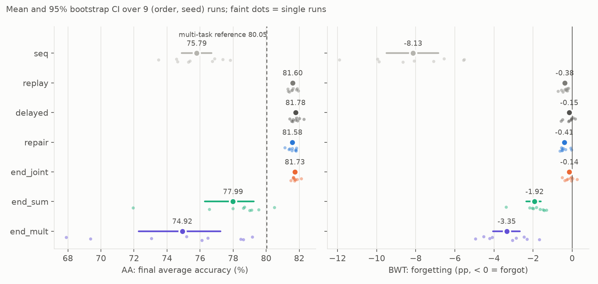
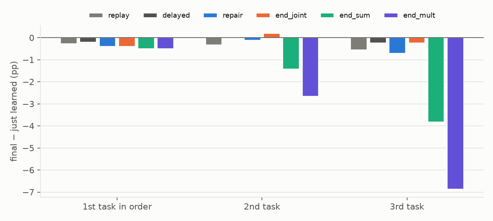
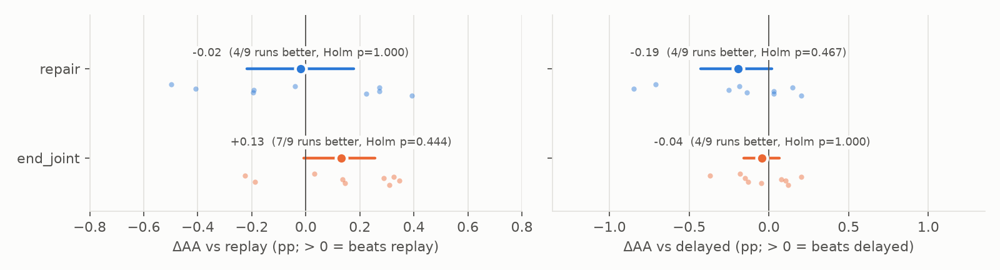
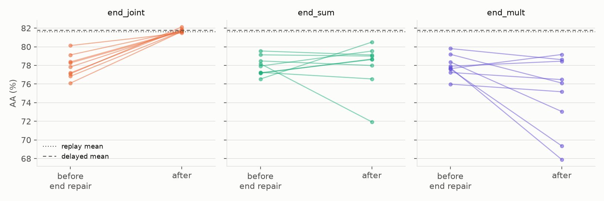
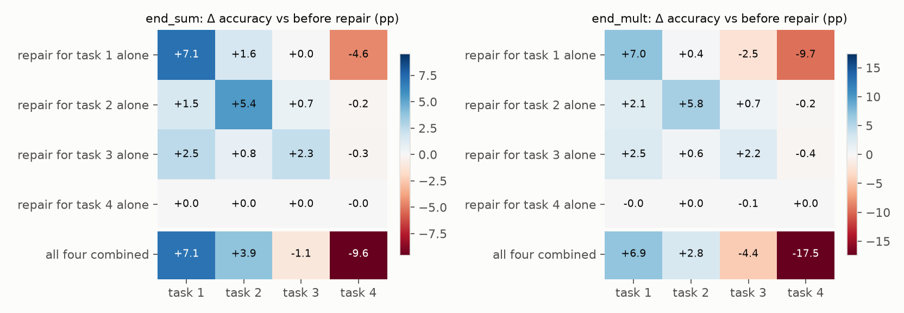
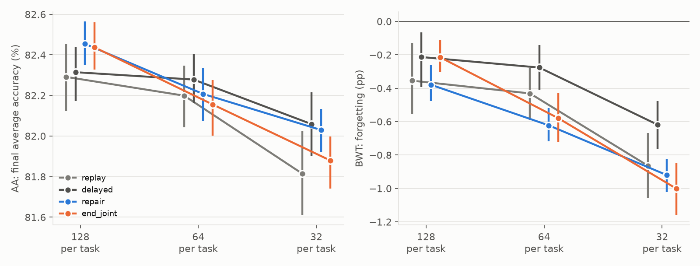
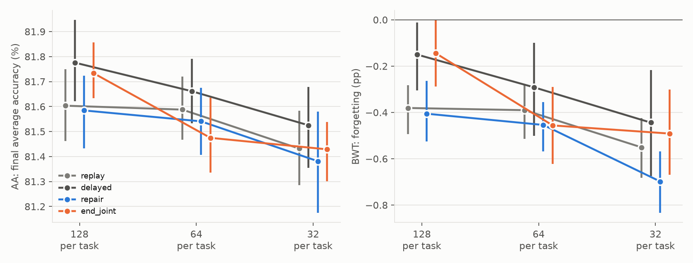
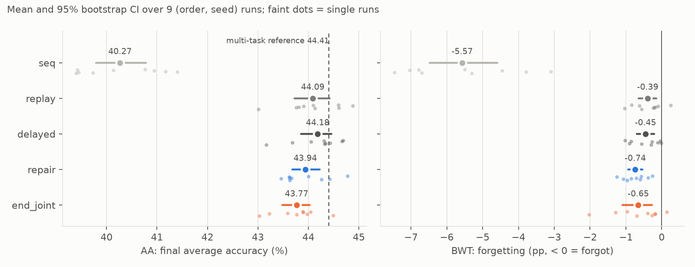
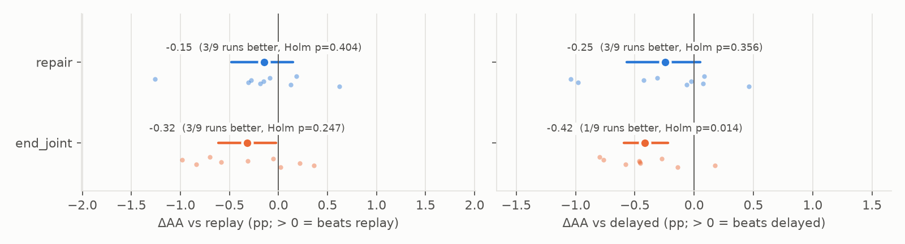

# Compensated LoRA repair for continual learning: all results in one place

Llama-3.2-1B; 3 task orders × 3 seeds = 9 runs per configuration. Two benchmarks:
- the Standard CL Benchmark: DBpedia, Amazon, Yahoo, AG News, all classification (Parts A–B);
- a generative benchmark: GSM8K, TriviaQA, HellaSwag, WMT14 en→de (Parts D–E).
LoRA sits on all 7 linear layers (q, k, v, o, gate, up, down), with a rank-8 learner plus a rank-8 repair per task.

**Layout of this document**
- **Summary**: every finding so far, on one page.
- **Part A**: end-of-sequence repair (joint, summed and multiplied repair adapters), with 128 stored examples per task and 1k training examples per class.
- **Part B**: how many stored examples are needed (128, 64 and 32 per task) at 1k and 2k training examples per class.
- **Part D**: the generative benchmark (math, QA, sentence completion, translation; 5k train / 1k test per task, 2 epochs).
- **Part E**: whether the methods protect general abilities (MMLU, ARC, Winogrande) on the generative benchmark.
- **Part F**: data-free protection, i.e. no stored old-task data (question, results, earlier evidence, methods, literature).
- **Part G**: baselines table for the classification benchmark (LoRA, O-LoRA, replay, delayed distillation; per dataset and order).
- **Part H**: data-budget baselines for constrained LoRA (5k, 10k and 100k examples per task; LoRA, O-LoRA, LoRA + TIES, replay, delayed distillation).
- **Part C**: the idea explained, with diagrams and the math of how LoRA adapters stack, the literature, and possible directions.
- **Appendix**: the full auto-generated statistics tables.

Section numbers inside a part (e.g. "Section 5") refer to that part.

## Summary of findings

**Terms used below**
- **AA**: final average accuracy over the 4 tasks.
- **LA**: accuracy on each task right after learning it.
- **BWT**: forgetting, i.e. final accuracy minus just-learned accuracy (0 means no forgetting).
- **Stored examples (anchors)**: a small memory per task. Old tasks are protected by matching the model's outputs on them, as recorded right after each task was learned.

| # | Finding | Evidence |
|---|---|---|
| 1 | **Summing or multiplying separately trained repair adapters makes forgetting worse.** | end_sum 77.99 AA and end_mult 74.92 AA, vs replay 81.60: 0/9 runs better, Holm p ≤ 0.009 (Part A §4). Each repair fixes its own task and damages the others, e.g. the last task falls −9.6 pp when summed and −17.5 pp when multiplied (Part A §5). |
| 2 | **One joint repair at the end, protecting all tasks including the last, is the best repair variant.** | 81.73 AA, BWT −0.14. It forgets significantly less than per-task direct repair (+0.26 pp BWT, 8/9 runs, Holm p = 0.038). |
| 3 | **No repair method significantly beats replay or delayed distillation, on either benchmark.** On classification this holds at 1k and 2k data and at 128, 64 and 32 stored examples per task. On the generative benchmark, end_joint is significantly **worse** than delayed distillation. | Classification: all Holm p ≥ 0.1 (Part A §4, Part B §5). Generative: end_joint − delayed = −0.42 AA, 1/9 runs better, Holm p = 0.014 (Part D §4). |
| 4 | **The protection comes from distilling recorded outputs on stored examples, not from the repair adapter.** Every memory-based method lands within about 0.2 pp of the others. | Part A §3, Part B §3, Part C §6. |
| 5 | **More training data means more forgetting, and the end repair recovers it.** Going from 1k to 2k examples per class doubles unprotected forgetting (−8 → −16 pp BWT). The end repair recovers +7.5 pp (75.0 → 82.4 AA). | Part B §3. |
| 6 | **Very few stored examples are needed.** 32 per task (128 in total) recovers 92–93% of what 128 per task recovers. Every method stays within 0.6 pp AA of its 128-example result. | Part B §4.3. |
| 7 | **The repair methods use their memory least efficiently.** At 2k data with 32 per task, delayed distillation loses only −0.26 pp, against −0.42 for direct repair and −0.56 for end_joint. The likely cause is that the repairs overfit a small memory (about 74 passes over each example). | Part B §4, §6. |
| 8 | **Where repair helps: learning.** With 2k data and 128 per task, direct repair learns new tasks significantly better than replay (+0.18 LA, Holm p = 0.038) and delayed (+0.26 LA, Holm p = 0.011). | Part B §3. |
| 9 | **The generative tasks interfere strongly, and protection fixes it.** Unprotected, GSM8K loses 11 of the 20 points it learned (average forgetting −5.6). Replay, delayed, direct repair and end_joint all recover +3.5 to +3.9 AA (9/9 runs), to within about 0.3–0.6 of multi-task training. | Part D §1, §3. |
| 10 | **With strong forgetting, repairing afterwards is worse than protecting during learning.** end_joint trails delayed distillation mostly on GSM8K (−1.19, 1/9 runs better) and HellaSwag (−0.57, 1/9). Long multi-step skills don't fully come back from a 128-example patch. | Part D §4–5. |
| 11 | **Protecting the tasks also protects general abilities, and repair does it worst.** Fine-tuning costs MMLU about −8.5 without protection. Replay and delayed distillation keep the 4-benchmark average at the base model's level. end_joint trails them by about 0.7 (0–1/9 runs better, Holm p = 0.021), and direct repair trails delayed by 0.5 (0/9, Holm p = 0.034). | Part E. |
| 12 | **Novelty:** every component has close prior work: BiC, DER, GDumb, Batch Model Consolidation, Representation Surgery. A novel contribution would have to be a finding or a setting where only a patch is possible, not the recipe itself. | Part C §7–8. |
| 13 | **Protection works without any stored data, and snapshot-difference selection is the best way to generate it.** With zero stored old-task examples, LwF-style, self-generated and snapshot-difference replay recover 97–104% of replay's gain on the generative benchmark, none significantly different from replay. Selecting self-generated examples by log p_t − log p_{t−1} beats plain generation (+0.28 AA, 8/9 runs, Holm p = 0.029) and has the highest AA (44.26) and least forgetting (BWT −0.27) of any continual method. On held-out general benchmarks they also match replay and stay at the base model's level. | Part F §2, Part E. |
| 14 | **All-layer O-LoRA is a real no-memory baseline, but stays behind the stored-example methods.** It beats seq by +3.95 AA at 1k and +8.70 at 2k (9/9 runs), and trails replay and delayed by about 2–3 AA (0/9 runs, Holm p < 0.001). | Part G. |
| 15 | **Full data with stored memory is the real target; small budgets lose only on learning.** On order 1, replay and delayed distillation at 100k per task reach 83.4 AA with almost no forgetting (BWT −0.6), while plain LoRA at 100k collapses to 46.1 AA (BWT −50.5). The best 5k and 10k methods (replay, delayed distillation) trail the 100k target by 2.5 and 1.5 AA (0/3 seeds), almost all of it lower LA, mostly on Amazon and Yahoo. That learning gap is what a constrained-LoRA method has to close. O-LoRA's protection weakens with data (BWT −13.5 at 100k); LoRA + TIES does not help. | Part H. |

**Open next steps.** These are not yet run:
- replicate the data-free result (df_diff vs df_gen) on another task set or model, and check generated examples for copies of training data;
- on the generative benchmark: delayed distillation plus an end repair, and fewer stored examples (32 per task);
- an end repair whose step count scales with memory size, to test the overfitting explanation;
- 16 and 8 stored examples per task;
- delayed distillation combined with an end repair;
- a null-space-constrained repair on a harder benchmark (Part C §9).

**Run notes.**
- One results file (`runs_a64/order3_s2/end_joint.json`) was rebuilt after two jobs wrote it at the same time.
- Two runs that timed out on the slow node node-05 were resubmitted; only the missing method was rerun.
- Earlier rounds used LoRA on attention only; those numbers are not comparable with the all-layer results here.

---

# Part A: end-of-sequence repair (1k per class, 128 stored examples)

## 1. Headline

| Question | Answer |
|---|---|
| Does **summing** separately trained per-task repairs reduce forgetting? | **No, it is much worse.** AA 77.99 vs replay 81.60: −3.61 pp, 0 of 9 runs better, Holm p = 0.009. |
| Does **multiplying** them? | **No, it is worse still.** AA 74.92: −6.68 pp vs replay, 0 of 9 runs better, Holm p = 0.007. It even falls below no protection at all on average (seq 75.79). |
| Does **one joint repair at the end**, protecting all 4 tasks including the last, help? | **Yes, it is the best repair variant.** AA 81.73 and BWT −0.14, the lowest forgetting of any method. It significantly beats direct (per-task) repair on forgetting (+0.26 pp, 8 of 9 runs, Holm p = 0.038). |
| Does anything beat replay and delayed distillation? | **Not significantly.** end_joint vs replay: +0.13 pp AA (7 of 9 runs), +0.24 pp BWT (unadjusted p = 0.025, Holm p = 0.098). end_joint vs delayed: −0.04 pp AA, a tie. |

**Bottom line:** moving the repair to the end and training it **jointly** on all tasks' stored examples lifts repair from slightly below replay to level with the best baseline (delayed distillation). It cuts forgetting to the lowest level we measured. It does **not** produce a statistically significant win over replay or delayed distillation. Summing or multiplying **independently trained** repairs fails, for the reason shown in Section 5.

## 2. What was run

Configuration changes from earlier rounds:
- LoRA on **all 7 linear layers** (q, k, v, o, gate, up, down) instead of attention-only q/v;
- learner rank 8 + repair rank 8 per task.

All methods share the same first-task adapter and see the same data in the same order.

| Method | During the task sequence | After the last task |
|---|---|---|
| `seq` | rank-16 adapter per task, plain training | nothing |
| `replay` | rank-16, matching the stored examples' recorded outputs on 25% of steps (spread out) | nothing |
| `delayed` | rank-16, matching the stored examples' recorded outputs on the last 25% of each task's steps | nothing |
| `repair` (direct) | rank-8 learner for 75% of steps, then frozen; new rank-8 repair trained on the last 25% (new-task data + earlier tasks' stored examples) | nothing |
| **`end_joint`** | rank-8 learner per task, plain training on all steps | **one** rank-24 repair trained on the stored examples of **all 4 tasks** at once |
| **`end_sum`** | same learners | **4** rank-6 repairs, one per task, each trained **alone** on its own task's stored examples; then **added** together |
| **`end_mult`** | same learners | same 4 per-task repairs, but each **multiplies** the layer output, y ← (I + BA)·y; applied as a **product** |
| `mtl` | reference: one rank-64 adapter trained on all four tasks shuffled together | — |

- **Stored memory:** 128 class-balanced examples per task. Their reference outputs are the model's answer probabilities, recorded right after that task was learned. For the last task that means the final model before repair.
- **Matched budget:** the end repair gets exactly the repair steps direct repair uses over tasks 2–4. That is 296 steps and 4,736 stored-example lookups in order 1 (78 + 156 + 62). Only the timing and the set of protected tasks differ.
- **Repair parameters:** the total repair rank is the same 24 in every repair method (3 × 8, 1 × 24 or 4 × 6).

### How it is scored

`a[i, j]` is the test accuracy on task j right after training on task i. T = 4 tasks.

```
AA  = (1/T)     Σ_j a[T, j]                      final average accuracy        (headline)
LA  = (1/T)     Σ_j a[j, j]                      accuracy right after learning
BWT = (1/(T−1)) Σ_{j<T} (a[T, j] − a[j, j])      forgetting; < 0 means forgot
AA  = LA + ((T−1)/T) · BWT
```

For the end methods, the final row is measured **after** the end repair. The pre-repair row is kept as `pre_repair`. So the last task's LA is its post-repair accuracy, and any damage the repair does to the last task shows up in LA.

**Significance.** Each comparison uses the 9 runs as paired units. For each we report:
- the mean difference with a 95% bootstrap CI (10k resamples);
- the number of runs where A beats B;
- three p-values: exact sign-flip permutation, Wilcoxon signed-rank, and paired t;
- a Holm correction on the t-test p, within each pre-declared family:
  - primary: each repair method vs replay and vs delayed (8 tests);
  - secondary: end variants vs direct repair and vs each other (6 tests);
  - sanity: vs seq (6 tests).

With 9 runs the exact tests cannot go below p = 2/512 = 0.0039, so the exact p is the assumption-free check, and the Holm-adjusted t-test p decides the stars.

## 3. Results

### 3.1 Summary (mean ± SD over 9 runs)

| Method | AA | LA | BWT (forgetting) | worst task drop | AA before end repair | min / run |
|---|---|---|---|---|---|---|
| seq | 75.79 ± 1.47 | 81.89 | −8.13 ± 2.17 | −12.56 | — | 10.5 |
| replay | 81.60 ± 0.24 | 81.89 | −0.38 ± 0.18 | −0.76 | — | 11.8 |
| delayed | **81.78** ± 0.26 | 81.89 | −0.15 ± 0.24 | **−0.53** | — | 11.8 |
| repair (direct) | 81.58 ± 0.24 | 81.89 | −0.41 ± 0.21 | −0.94 | — | 15.8 |
| **end_joint** | 81.73 ± **0.18** | 81.84 | **−0.14** ± 0.23 | −0.72 | 77.88 | 15.6 |
| end_sum | 77.99 ± 2.51 | 79.43 | −1.92 ± 0.62 | −3.93 | 77.94 | 30.4 |
| end_mult | 74.92 ± 4.06 | 77.43 | −3.35 ± 1.13 | −6.87 | 77.95 | 30.3 |
| mtl (reference) | 80.05 ± 0.87 | — | — | — | — | 7.5 |

Notes:
- **All-layer LoRA raised every number.** Earlier attention-only (q/v, rank 12) results were replay 79.67, delayed 79.72, repair 79.41. They are now 81.60, 81.78 and 81.58. The two rounds also differ in rank and in the multi-task reference, so this is not a controlled comparison.
- **Multi-task (80.05) is below the protected sequential methods.** It is one rank-64 adapter given one pass over all data. So in this setup it is a loose reference, not an upper bound.



### 3.2 Final accuracy per task (mean over runs)

| Method | AG News | Amazon | DBpedia | Yahoo |
|---|---|---|---|---|
| seq | 88.46 | 53.39 | 89.60 | 71.74 |
| replay | 91.04 | 61.84 | 98.85 | 74.68 |
| delayed | **91.33** | 62.12 | 98.88 | **74.78** |
| repair | 90.79 | 62.04 | 98.94 | 74.57 |
| end_joint | 91.17 | **62.23** | **98.97** | 74.57 |
| end_sum | 86.46 | 60.54 | 95.02 | 69.95 |
| end_mult | 83.17 | 59.27 | 92.30 | 64.94 |

### 3.3 Per task order (AA, mean over 3 seeds)

| Order | seq | replay | delayed | repair | end_joint | end_sum | end_mult |
|---|---|---|---|---|---|---|---|
| order1 (dbp→amz→yah→agn) | 75.55 | 81.56 | 81.67 | **81.71** | 81.65 | 79.22 | 77.72 |
| order2 (dbp→amz→agn→yah) | 75.56 | 81.65 | 81.90 | 81.54 | **81.91** | 77.72 | 72.96 |
| order3 (yah→amz→agn→dbp) | 76.28 | 81.59 | **81.76** | 81.51 | 81.64 | 77.04 | 74.08 |

The top three (delayed, end_joint, repair) trade places across orders and are never more than 0.2 pp apart. end_sum and end_mult are last in every order.

### 3.4 Forgetting by position in the order



end_joint forgets least on the 2nd task in each order. It even gains on that task (+0.17 pp) and matches delayed on the 3rd. The large losses for end_sum and end_mult on the 2nd and 3rd tasks are damage done **by the repair itself** (Section 5), not forgetting during training.

## 4. Significance

### 4.1 Primary: can a repair method beat replay or delayed distillation? (Holm over 8)

AA:

| A − B | mean Δ | 95% CI | A better | p exact | p Wilcoxon | p t | p Holm |
|---|---|---|---|---|---|---|---|
| repair − replay | −0.02 | [−0.22, +0.18] | 4/9 | 0.871 | 1.000 | 0.864 | 1.000 |
| repair − delayed | −0.19 | [−0.43, +0.02] | 4/9 | 0.184 | 0.301 | 0.156 | 0.467 |
| **end_joint − replay** | **+0.13** | [−0.01, +0.26] | **7/9** | 0.113 | 0.129 | 0.111 | 0.444 |
| end_joint − delayed | −0.04 | [−0.16, +0.07] | 4/9 | 0.516 | 0.570 | 0.509 | 1.000 |
| end_sum − replay | −3.61 | [−5.23, −2.41] | 0/9 | 0.004 | 0.004 | 0.002 | **0.009 \*** |
| end_sum − delayed | −3.78 | [−5.40, −2.57] | 0/9 | 0.004 | 0.004 | 0.001 | **0.009 \*** |
| end_mult − replay | −6.68 | [−9.26, −4.44] | 0/9 | 0.004 | 0.004 | <0.001 | **0.007 \*** |
| end_mult − delayed | −6.86 | [−9.43, −4.60] | 0/9 | 0.004 | 0.004 | <0.001 | **0.007 \*** |

BWT (forgetting; positive = A forgets less):

| A − B | mean Δ | 95% CI | A better | p exact | p Wilcoxon | p t | p Holm |
|---|---|---|---|---|---|---|---|
| repair − replay | −0.02 | [−0.17, +0.12] | 4/9 | 0.758 | 1.000 | 0.765 | 1.000 |
| repair − delayed | −0.26 | [−0.44, −0.07] | 3/9 | 0.055 | 0.098 | 0.037 | 0.110 |
| **end_joint − replay** | **+0.24** | **[+0.07, +0.38]** | **7/9** | **0.031** | **0.039** | **0.025** | 0.098 |
| end_joint − delayed | +0.01 | [−0.16, +0.16] | 5/9 | 0.961 | 0.820 | 0.952 | 1.000 |
| end_sum − replay | −1.54 | [−2.02, −1.14] | 0/9 | 0.004 | 0.004 | <0.001 | **0.001 \*** |
| end_sum − delayed | −1.77 | [−2.28, −1.34] | 0/9 | 0.004 | 0.004 | <0.001 | **<0.001 \*** |
| end_mult − replay | −2.97 | [−3.69, −2.24] | 0/9 | 0.004 | 0.004 | <0.001 | **<0.001 \*** |
| end_mult − delayed | −3.20 | [−3.95, −2.44] | 0/9 | 0.004 | 0.004 | <0.001 | **<0.001 \*** |



**Reading it:**
- **end_joint forgets less than replay.** The CI excludes zero and every test gives p < 0.05 on its own. The difference does not survive Holm correction over 8 tests (0.098).
- **On final accuracy, end_joint vs replay** is +0.13 pp with 7/9 runs better, but not significant.
- **end_joint vs delayed is a tie** on everything.
- **No repair variant significantly beats either baseline.** Both summing and multiplying are significantly **worse**.

### 4.2 Secondary: end variants vs direct repair and each other (Holm over 6)

| A − B | ΔAA | A better | p Holm (AA) | ΔBWT | A better | p Holm (BWT) |
|---|---|---|---|---|---|---|
| **end_joint − repair** | +0.15 [−0.02, +0.35] | 6/9 | 0.177 | **+0.26 [+0.05, +0.43]** | **8/9** | **0.038 \*** |
| end_sum − repair | −3.59 | 0/9 | 0.008 \* | −1.52 | 0/9 | <0.001 \* |
| end_mult − repair | −6.66 | 0/9 | 0.006 \* | −2.94 | 0/9 | <0.001 \* |
| end_sum − end_mult | +3.07 | 9/9 | 0.008 \* | +1.42 | 9/9 | 0.004 \* |
| end_sum − end_joint | −3.74 | 0/9 | 0.008 \* | −1.78 | 0/9 | <0.001 \* |
| end_mult − end_joint | −6.81 | 0/9 | 0.006 \* | −3.20 | 0/9 | <0.001 \* |

Moving repair to the end **and training it jointly** significantly reduces forgetting compared with per-task direct repair. It is the one significant improvement to the repair method in this round.

### 4.3 Sanity (vs no protection)

Replay, delayed, repair and end_joint all beat seq by about 5.8–6.0 pp AA and about 7.7–8.0 pp BWT, in 9/9 runs (Holm p < 0.001). end_sum's AA gain over seq is not significant (+2.20, Holm p = 0.18). end_mult is not distinguishable from doing nothing (−0.87, Holm p = 0.61).

## 5. Why summing and multiplying fail, and joint training works



All three end methods start from the same point: 77.9 AA after learning without protection. **end_joint lifts every one of the 9 runs to 81.5–82.1.** end_sum barely moves on average (77.94 → 77.99). end_mult goes **down** (77.95 → 74.92) and sometimes collapses to about 68.



This figure shows the change in accuracy per task when each per-task repair is applied **alone**, and when all four are combined:

1. **Each repair fixes its own task and hurts others.**
   - The task-1 repair restores task 1 by +7 pp but costs the last task −4.6 pp (sum) or −9.7 pp (mult).
   - Each repair was trained only to restore its own task's outputs. Nothing told it to leave the other tasks alone.
2. **The last task's own repair does nothing.**
   - Its reference outputs are the model's own current outputs, so its loss starts at zero (about 0.00005) and there is nothing to learn.
   - "Repairing the last task" only helps as a **constraint inside a joint repair**: it stops the other tasks' repairs from damaging it. As an independent adapter, it is inert.
3. **Combining makes the damage add up.**
   - Summed: the last task loses −9.6 pp and the 3rd task −1.1 pp.
   - Multiplied: −17.5 and −4.4. In the product (I+R₄)(I+R₃)(I+R₂)(I+R₁)W, each repair also acts on the others' outputs, so the cross-terms amplify the interference.
   - This is the same failure as naive task-arithmetic merging. Independently trained updates were never trained to coexist.

**end_joint has none of these problems.** Its single repair sees all four tasks' stored examples in every batch, so it must find one update that restores tasks 1–3 **while keeping the last task where it was**. This is the useful core of "repair all tasks, including the last": the last task's 128 examples matter as a guard-rail, not as something to fix.

## 6. Conclusions

1. **Summing or multiplying independently trained repair adapters does not reduce forgetting.** It increases forgetting significantly (0/9 runs better than replay, Holm p ≤ 0.009), and multiplying is worse than summing (9/9 runs).
2. **A single repair trained jointly at the end, protecting all tasks including the last, is the best repair variant so far.**
   - It ties delayed distillation on accuracy (81.73 vs 81.78) and has the lowest forgetting of any method (BWT −0.14).
   - It significantly reduces forgetting compared with per-task direct repair (+0.26 pp BWT, 8/9 runs, Holm p = 0.038).
   - It also has the lowest run-to-run spread (SD 0.18).
3. **The goal of significantly beating replay and delayed distillation is not met.**
   - end_joint forgets less than replay (+0.24 pp BWT, p = 0.025 unadjusted), but this does not survive correction (Holm p = 0.098), and its accuracy gain (+0.13) is not significant.
   - Against delayed distillation it is a dead heat.
4. **The forgetting left to recover is small.** With all-layer LoRA, the protected methods sit within about 0.4 pp of zero forgetting (BWT −0.14 to −0.41) and within 0.2 pp AA of each other. A real but small advantage (about 0.1–0.2 pp) would need far more runs to show. With the observed spread, 9 runs can reliably detect about 0.3 pp.

## 7. Possible next steps

- **Make the benchmark harder, so there is forgetting to win back.** For example, a longer sequence (the 15-task long-sequence benchmark), fewer stored examples (e.g. 32 per task), or more training per task. When baselines already sit near zero forgetting, no method can separate from them.
- **Increase power for the end_joint vs replay test.** More seeds (e.g. 5 per order, 15 runs) would test whether the +0.24 pp BWT advantage is real.
- **Combine the two winners.** Delayed distillation during the sequence plus a joint end repair: the end repair could clean up the drift that delayed distillation leaves.
- **Drop end_sum and end_mult.** The per-task diagnostic shows they fail by construction (interference between independently trained repairs), not because of tuning.

---

# Part B: how many stored examples are needed (128 / 64 / 32 per task, 1k and 2k per class)

## 1. Headline

1. **Very few stored examples are needed.**
   - With only **32 per task**, which is 128 in total and about 2 per DBpedia class, the end repair still recovers **92–93%** of what 128 per task recovers.
   - Every protected method stays within **0.6 pp AA** of its 128-example result.
   - Without protection, the model loses 6–12 pp.
2. **Fewer examples does hurt, measurably.** At 32 per task every method is significantly worse than at 128 in 9 out of 9 runs. The loss is about **twice as large with 2k training examples per class** (0.26–0.56 pp) as with 1k (0.17–0.30 pp).
3. **The two repair methods are the most memory-hungry. Delayed distillation is the most memory-efficient.**
   - With 128 per task, the repairs are slightly ahead (2k data).
   - At 64 per task they already lose 0.25–0.28 pp, while delayed distillation loses nothing (−0.04).
   - At 32 per task delayed distillation is best, and it forgets less than end_joint (−0.38 pp BWT, 7/9 runs; p = 0.02 unadjusted, Holm p = 0.11).
4. **There is still no significant win for repair over replay or delayed distillation, at any memory size or data size.**

## 2. Setup

| | 1k per class (original) | 2k per class (new) |
|---|---|---|
| training examples | DBpedia 14k, Amazon 5k, Yahoo 10k, AG News 4k | DBpedia 28k, Amazon 10k, Yahoo 20k, AG News 8k |
| test examples | 500 per class | 500 per class (a different random draw, so not paired with 1k) |
| data folder / runs | `data/` → `runs/`, `runs_a64/`, `runs_a32/` | `data_2k/` → `runs_2k/`, `runs_2k_a64/`, `runs_2k_a32/` |

- **Memory sizes.** 64 and 32 per task are **class-balanced subsets of the same 128 stored examples**, identical across methods and seeds.
- **Paired design.** Within each data size, all memory sizes reuse **the same first-task adapter** from the 128-example run, so memory size is the only thing that changes, and differences are paired per run.
- **Same compute at every memory size.** The number of protection steps does not change; a smaller memory is cycled through more often. For example, end_joint at 2k data uses 592 steps of 16, which is about 18 passes over 512 examples at 128 per task and about **74 passes** over 128 examples at 32 per task.
- **Methods:**
  - replay: matches recorded outputs on 25% of steps, spread out;
  - delayed: matches recorded outputs on the last 25% of steps;
  - direct repair: a separate repair adapter for the last 25% of each task;
  - end_joint: one repair adapter after the last task, using all tasks' stored examples.

## 3. Doubling the training data (128 per task)

| Method | AA 1k | AA 2k | BWT 1k | BWT 2k | LA 2k |
|---|---|---|---|---|---|
| seq (no protection) | 75.79 | 70.32 | −8.13 | **−16.28** | 82.52 |
| replay | 81.60 | 82.29 | −0.38 | −0.35 | 82.56 |
| delayed | **81.78** | 82.31 | −0.15 | −0.21 | 82.47 |
| direct repair | 81.58 | **82.45** | −0.41 | −0.38 | **82.74** |
| end_joint | 81.73 | 82.44 | −0.14 | −0.22 | 82.60 |
| multi-task reference | 80.05 | 81.29 | — | — | — |

- **Twice the data means twice the unprotected forgetting.** Seq's BWT falls from −8 to −16 pp, and Amazon falls to about 40%.
- **Protection still works.** Every protected method forgets less than 0.4 pp, and end_joint recovers **+7.46 pp** (74.98 → 82.44), against +3.85 at 1k.
- **The repair methods are slightly ahead at 2k, but not significantly.** Their AA vs replay is +0.15/+0.16 (6–7/9 runs, Holm p = 0.39).
- **Direct repair learns new tasks significantly better.** Its LA beats replay by +0.18 (7/9, Holm p = 0.038) and delayed by +0.26 (8/9, Holm p = 0.011). Its learner trains on new data without a protection loss mixed in, and the separate adapter does the protecting.

## 4. Shrinking the memory

### 4.1 Final accuracy (AA, mean over 9 runs)

| Method | 1k: 128 | 64 | 32 | Δ32 | 2k: 128 | 64 | 32 | Δ32 |
|---|---|---|---|---|---|---|---|---|
| replay | 81.60 | 81.59 | 81.43 | −0.17 \* | 82.29 | 82.20 | 81.82 | −0.48 \* |
| delayed | **81.78** | **81.66** | **81.53** | −0.25 | 82.31 | **82.28** | **82.06** | **−0.26 \*** |
| direct repair | 81.58 | 81.54 | 81.38 | −0.20 | **82.45** | 82.21 | 82.03 | −0.42 \* |
| end_joint | 81.73 | 81.47 | 81.43 | −0.30 \* | 82.44 | 82.16 | 81.88 | −0.56 \* |

\* = significantly below the same method at 128 after Holm correction over 8 tests. Every Δ32 is negative in 8–9 of 9 runs.





### 4.2 Forgetting (BWT)

| Method | 1k: 128 | 64 | 32 | 2k: 128 | 64 | 32 |
|---|---|---|---|---|---|---|
| replay | −0.38 | −0.39 | −0.55 | −0.35 | −0.43 | −0.86 |
| delayed | −0.15 | −0.29 | −0.44 | **−0.21** | **−0.28** | **−0.62** |
| direct repair | −0.41 | −0.45 | −0.70 | −0.38 | −0.62 | −0.92 |
| end_joint | **−0.14** | −0.46 | −0.49 | −0.22 | −0.58 | −1.00 |

### 4.3 How much the end repair wins back

| Memory per task | Total stored | 1k: before → after | recovered | share | 2k: before → after | recovered | share |
|---|---|---|---|---|---|---|---|
| 128 | 512 | 77.88 → 81.73 | +3.85 | 100% | 74.98 → 82.44 | +7.46 | 100% |
| 64 | 256 | 77.89 → 81.47 | +3.59 | 93% | 75.17 → 82.16 | +6.99 | 96% |
| 32 | 128 | 77.76 → 81.43 | +3.67 | 92% | 74.84 → 81.88 | +7.04 | 93% |

128 examples in total, across 4 tasks, recover 7 of the 7.5 pp lost.

## 5. Significance: end_joint vs the baselines at each memory size (2k data)

Holm correction over the 6 comparisons per metric.

| | AA Δ | runs better | Holm p | BWT Δ | runs better | p (unadj.) | Holm p |
|---|---|---|---|---|---|---|---|
| vs replay @128 | +0.15 | 6/9 | 0.51 | +0.14 | 5/9 | 0.33 | 1.00 |
| vs replay @64 | −0.04 | 4/9 | 1.00 | −0.15 | 3/9 | 0.35 | 1.00 |
| vs replay @32 | +0.06 | 4/9 | 1.00 | −0.14 | 4/9 | 0.49 | 1.00 |
| vs delayed @128 | +0.12 | 8/9 | 0.49 | −0.00 | 3/9 | 0.99 | 1.00 |
| vs delayed @64 | −0.12 | 3/9 | 0.56 | **−0.30** | **1/9** | **0.018** | 0.11 |
| vs delayed @32 | −0.18 | 3/9 | 0.47 | **−0.38** | **2/9** | **0.020** | 0.11 |

The 1k data shows the same pattern: no comparison is significant at any memory size. The full tables are in the Appendix.

## 6. Interpretation

1. **The forgetting here is cheap to undo.** About 30 examples per task, distilled toward recorded outputs, restore over 90% of 4–8 pp of lost accuracy. This is consistent with the "spurious forgetting" view: the model mostly loses *alignment* to old tasks, not the knowledge itself.
2. **How the memory is used matters more as it shrinks.**
   - **Delayed distillation** mixes stored examples into new-task training for the last 25% of steps. Each stored example appears next to fresh data, so it is hard to overfit a small memory.
   - **end_joint and direct repair** fit a separate adapter **on the stored examples alone** for a fixed number of steps. With 32 per task that is about 74 passes over each example at 2k data. That likely overfits the small memory, so their recovery generalises less to the test sets.
   - This is a testable hypothesis. Giving the repairs **fewer steps when memory is small** (constant passes rather than constant steps), or adding new-task data during end repair, should close the gap if it is right.
3. **The position of repair methods:** they are marginally best when memory is plentiful (128 per task) and marginally worst when it is scarce (32 per task). They never significantly beat replay or delayed distillation. Combined with the earlier findings, the strongest consistent statement is: **output distillation on stored examples is what protects. A separate repair adapter changes where that correction lives, which helps learning slightly (higher LA), and costs memory efficiency.**

## 7. Suggested next steps

| Step | Why | Cost |
|---|---|---|
| End repair with **steps scaled to memory size** (e.g. constant 9 passes), at 32 and 16 per task | tests the overfitting explanation in 6.2; may let end_joint keep up with delayed at small memory | ~4 GPU-h |
| **16 and 8 per task** for delayed and end_joint | find where recovery actually breaks; 8 per task leaves some DBpedia classes unrepresented | ~6 GPU-h |
| **delayed + end_joint combined** | delayed's memory efficiency plus the end repair's cleanup of final drift | ~3 GPU-h |
| Repair with **new-task data mixed in** during end repair | the same regularisation delayed gets "for free" | ~3 GPU-h |

## Notes

- **One results file was rebuilt.** `runs_a64/order3_s2/end_joint.json` was written at the same time by two jobs: my resubmission (66003026) and a duplicate submission (66003029) that I did not make. I kept 66003029's complete record, which matches the prediction and adapter files it wrote. The two runs differ by ≤ 0.5 pp per task on that one run, so the means are unaffected. 
- **Two runs were resubmitted** after timing out on the slow node node-05: 1k-a64 order3_s2 and 1k-a32 order2_s2. The resubmissions finished only the missing method (end_joint); the methods already completed were kept.
- **Code changes:**
  - `run_order.py --anchors N --task0-from DIR --data-dir DIR`;
  - `prepare.py --out DIR`;
  - `scripts/report_anchors.py` writes the tables and figures, with `--roots 128=… 64=… 32=…`.

---

# Part C: the idea, how LoRA adapters stack, literature, and directions

## 1. The problem in one picture

We train one model on tasks one after another: DBpedia → Amazon → Yahoo → AG News. Each new task pulls the weights toward what it needs, and accuracy on earlier tasks drops. That drop is **forgetting**.

```
accuracy on task 1 (DBpedia)

 98.5 ┤ ●─────╮                         learned task 1
      │       ╰──────╮                  learning task 2 drags the weights
      │              ╰────────╮         learning task 3 drags them further
 89.6 ┤                       ╰──── ●   after task 4: lost ~9 pp  (seq, no protection)
      └──────┬───────┬────────┬─────────
          task 1  task 2   task 3   task 4
```

The two things we want to balance:

| Goal | Measured by | Want |
|---|---|---|
| **Learn** each new task well | LA = accuracy right after learning each task | high |
| **Keep** old tasks | BWT = final accuracy − accuracy right after learning | close to 0 |

Final average accuracy combines both: **AA = LA + ¾ · BWT** (with 4 tasks).

---

## 2. LoRA: one layer, then many stacked

### 2.1 One LoRA adapter on one weight matrix

A linear layer computes $y = W_0 x$, with $W_0 \in \mathbb{R}^{d_{out} \times d_{in}}$ frozen (the pretrained weights). LoRA adds a trainable low-rank path next to it:

$$
y \;=\; W_0 x \;+\; s\, B A x, \qquad A \in \mathbb{R}^{r \times d_{in}},\; B \in \mathbb{R}^{d_{out} \times r},\; s = \alpha / r
$$

- $r$ is the rank, small (8 here) compared with $d_{in} = 2048$.
- $A$ starts random (Kaiming-uniform). $B$ starts at **zero**, so a new adapter has no effect at the start ($BA = 0$).
- Only $A$ and $B$ are trained. That is $r(d_{in} + d_{out})$ numbers instead of $d_{in} \cdot d_{out}$.

```
            x  (d_in = 2048)
            │
     ┌──────┴───────────────┐
     │                      │
     ▼                      ▼
 ┌────────┐           ┌──────────┐
 │  W₀    │ frozen    │ A  (r×d) │ trainable  ── squeeze to r = 8 numbers
 │ d_out× │           └────┬─────┘
 │ d_in   │                ▼
 └───┬────┘           ┌──────────┐
     │                │ B  (d×r) │ trainable  ── expand back to d_out
     │                └────┬─────┘
     │                     │ × s
     └────────(+)──────────┘
               │
               ▼
               y
```

In our models this pair sits on **all 7 linear layers** of every transformer block: the attention projections q, k, v, o and the MLP projections gate, up, down. Llama-3.2-1B has 16 blocks, so 112 adapted matrices.

### 2.2 Stacking: one adapter per task, all added together

Each task $k$ gets its own adapter $(A_k, B_k)$. After training, it is frozen and the next task gets a fresh one. The forward pass **adds** every adapter's output:

$$
y \;=\; W_0 x \;+\; \sum_{k=1}^{K} s\, B_k A_k x
\;=\; \Big(\underbrace{W_0 + \textstyle\sum_k s\, B_k A_k}_{W_{\text{eff}}}\Big)\, x
$$

```
            x
            │
   ┌────────┼──────────┬──────────┬──────────┐
   ▼        ▼          ▼          ▼          ▼
 [ W₀ ]  [B₁A₁]     [B₂A₂]     [B₃A₃]     [B₄A₄]
 frozen  task 1     task 2     task 3     task 4 (training now)
         frozen     frozen     frozen
   │        │          │          │          │
   └───────(+)────────(+)────────(+)────────(+)──▶ y
```

Three facts about stacking:

1. **Stacking is summing.** The model only ever sees $W_{\text{eff}}$. The order of the branches does not matter.
2. **It is one big LoRA with a block structure.** Put the factors side by side and the stack is a single adapter of rank $\sum_k r_k$:
$$
\sum_k B_k A_k \;=\; \underbrace{[\,B_1 \; B_2 \; \cdots \; B_K\,]}_{d_{out} \times \sum r_k}\;
\underbrace{\begin{bmatrix} A_1 \\ A_2 \\ \vdots \\ A_K \end{bmatrix}}_{\sum r_k \times d_{in}}
$$
   The only difference from training that big adapter directly is **which block is allowed to change when**.
3. **New adapters do not isolate tasks.** Task 4's adapter changes $W_{\text{eff}}$, and task 1 is processed by the same $W_{\text{eff}}$. Freezing old adapters keeps *their* parameters fixed, not *their tasks' behaviour*. That gap is where forgetting comes from.

### 2.3 How the repair adapter fits in

The repair method splits each task's budget into a **learner** (rank 8) and a separate **repair** (rank 8):

$$
W_{\text{eff}} \;=\; W_0 \;+\; \sum_k \underbrace{s\,B^{L}_k A^{L}_k}_{\text{learner }k} \;+\; \sum_j \underbrace{s\,B^{R}_j A^{R}_j}_{\text{repair }j}
$$

- The learner is trained to do the new task.
- The repair is trained only to **undo the damage** the learner did to old tasks, while the learner is frozen.
- Mathematically the repair is just another additive LoRA branch. What makes it a "repair" is **what it is trained on** (Section 3) and **when** (Section 4).

### 2.4 Multiplicative composition (the `end_mult` variant)

Instead of adding, a repair can **multiply** the layer's output:

$$
y \;=\; (I + s\,B_R A_R)\, W_{\text{eff}}\, x \;=\; W_{\text{eff}} x + s\,B_R \underbrace{(A_R W_{\text{eff}})}_{\text{a constrained } A} x
$$

So a single multiplicative repair is **still a rank-$r$ additive update**. Its "A" matrix is forced to be $A_R W_{\text{eff}}$: it can only read directions that $W_{\text{eff}}$ already produces. With several repairs applied as a product:

$$
(I+R_4)(I+R_3)(I+R_2)(I+R_1)\, W_{\text{eff}}
\;=\; W_{\text{eff}} + \sum_j R_j W_{\text{eff}} \;+\; \underbrace{\sum_{i>j} R_i R_j W_{\text{eff}} + \dots}_{\text{cross-terms: each repair acts on the others' outputs}}
$$

The cross-terms are what makes multiplying worse than summing in our results. Repairs that were trained separately now also transform each other's corrections.

```
 sum:       y = W_eff x + R₁x + R₂x + R₃x + R₄x          (repairs side by side)

 product:   x ─▶[W_eff]─▶[I+R₁]─▶[I+R₂]─▶[I+R₃]─▶[I+R₄]─▶ y   (repairs in series)
                          each stage sees the previous stages' edits
```

---

## 3. What "trained against recorded outputs" means

This is the heart of every method that protects old tasks here: replay, delayed distillation, and every repair variant.

### 3.1 The recording

Each task has **128 stored examples** (the "anchors"), class-balanced and drawn from that task's training set. **Right after task $j$ is learned**, we run the model on task $j$'s 128 anchors and save its **answer probabilities**. These saved probabilities are the "recorded outputs", also called the **teacher**.

Example: an AG News anchor (options A = World, B = Sports, C = Business, D = Sci/Tech), right after learning AG News:

```
 recorded  p = [ A 0.02 | B 0.01 | C 0.91 | D 0.06 ]     ← saved to disk, never changes
```

### 3.2 Later, the model drifts

After learning more tasks, the same anchor gives:

```
 current   q = [ A 0.10 | B 0.05 | C 0.55 | D 0.30 ]     ← still says C, but much less sure
```

### 3.3 "Training against" = minimising the gap to the recording

The protecting component (a repair adapter, or the learner itself in replay/delayed) is updated to make $q$ match $p$ again. The gap is measured with KL divergence, restricted to the task's own answer letters:

$$
\mathcal{L}_{\text{KL}} \;=\; \frac{1}{|\text{batch}|}\sum_{x \in \text{anchors}} \sum_{c \,\in\, \text{task letters}} p_c(x)\, \log \frac{p_c(x)}{q_c(x)}
$$

- $\mathcal{L}_{\text{KL}} = 0$ exactly when the current model reproduces the recording.
- It is a **soft** target: the model is pushed to reproduce the whole distribution, including "C is likely and D is a bit plausible". It is not pushed only toward the gold label. This is called **distillation**: the model's past self is the teacher.
- The recording is used, **not the gold label**. Every method here protects old tasks the same way, so the comparison is fair.

```
                                    ┌───────────────────────────┐
  after task j:   anchors_j ──▶ model ──▶  p  (saved)           │
                                    └───────────────────────────┘
                                                   │
  later:          anchors_j ──▶ model + repair ──▶ q            │
                                         ▲         │            │
                                         │         ▼            ▼
                                         └──── KL( p ‖ q ) ◀────┘
                                    gradient flows only into the repair
```

### 3.4 Two meanings of "against"

| Phrase | Meaning |
|---|---|
| trained against **recorded outputs** | the **target**: make the current outputs match $p$ |
| trained against **the final model** | the **frozen base it sits on**: the repair is fitted on top of the model as it is after the last task, so it corrects the damage that actually exists at test time |

### 3.5 Why the last task's own repair learns nothing

For the last task, the recording $p$ is taken from the final model itself. So at the start of repair $q = p$, $\mathcal{L}_{\text{KL}} = 0$, and the gradient is zero:

$$
\frac{\partial \mathcal{L}}{\partial B_R} \;=\; \underbrace{\frac{\partial \mathcal{L}}{\partial y}}_{=\,0 \text{ when } q = p}\,(A_R x)^\top = 0
$$

We measured exactly this: that repair's loss started at about 0.00005 and its effect on accuracy was ±0.0 pp. Including the last task is therefore useful **only as a constraint** inside a joint repair: "while you fix tasks 1–3, do not move task 4".

---

## 4. All the methods we compared, as timelines

The training budget is one pass over each task's data; "25%" means the last quarter of a task's steps.

```
legend:  ████ train on new task (cross-entropy)     ░░░░ also match recordings on old anchors (KL)
         L = learner adapter   R = repair adapter    ❄ = frozen afterwards

             task 2                        task 3                        task 4              after task 4
seq        L ██████████████████ ❄        L ██████████████████ ❄        L ██████████████████ ❄
replay     L ███░███░███░███░██ ❄        L ███░███░███░███░██ ❄        L ███░███░███░███░██ ❄     (KL every 4th step)
delayed    L ██████████████░░░░ ❄        L ██████████████░░░░ ❄        L ██████████████░░░░ ❄     (KL in last 25%)
repair     L ██████████████ ❄            L ██████████████ ❄            L ██████████████ ❄
                         R ░░░░ ❄                      R ░░░░ ❄                      R ░░░░ ❄   (R: new data + old anchors)
end_joint  L ██████████████████ ❄        L ██████████████████ ❄        L ██████████████████ ❄   R ░░░░░░░░░░░░ ❄
                                                                                              one rank-24 repair,
                                                                                              anchors of ALL 4 tasks mixed
end_sum    (same learners)                                                                     R₁ ░░░ R₂ ░░░ R₃ ░░░ R₄ ░░░
                                                                                              each alone, own task only;
                                                                                              then ADD all four
end_mult   (same learners)                                                                     same, then MULTIPLY all four
```

The budget matches across methods. Every protected method sees the same 128 anchors per task and the same recordings, and the end repairs use exactly as many repair steps as direct repair (296 steps, 4,736 anchor lookups in order 1).

---

## 5. Why summing or multiplying separate repairs fails

Picture each repair as a vector in weight space. Each one is trained alone to restore its own task, with no term that cares about the others:

```
            restores task 1
                 ▲
                 │  R₁
                 │                 R₁ + R₂ + R₃  overshoots into a direction that
                 │                 nobody checked, and task 4 sits right there
                 │        ↗
                 │     ↗  R₂
                 │  ↗
                 ●─────────────▶ R₃
             final model
```

Measured, as accuracy change vs before repair, averaged over 9 runs:

| | task 1 | task 2 | task 3 | task 4 (last) |
|---|---|---|---|---|
| repair for task 1 alone (sum) | **+7.1** | +1.6 | +0.0 | −4.6 |
| repair for task 4 alone (sum) | 0.0 | 0.0 | 0.0 | 0.0 |
| **all four summed** | +7.1 | +3.9 | −1.1 | **−9.6** |
| **all four multiplied** | +6.9 | +2.8 | −4.4 | **−17.5** |

Two causes, both necessary:

1. **Each repair never saw the others.** Each corrects the model *it was trained on*. Once the others are switched on, that model no longer exists.
2. **Each repair's loss only covered its own task.** Nothing penalised the task-1 repair for damaging task 4.

`end_joint` avoids both: one repair, with all four tasks' anchors in every batch. It must find **one** update that restores tasks 1–3 **and** leaves task 4 where it was. It lifted every one of the 9 runs from about 77.9 to 81.5–82.1 AA.

This is the same failure model-merging papers report when independently trained task vectors are added naively (Section 7.4).

---

## 6. What the experiments say

All-layer LoRA, 9 runs per method:

| Method | AA | LA (learning) | BWT (forgetting) |
|---|---|---|---|
| seq (no protection) | 75.79 | 81.89 | −8.13 |
| replay | 81.60 | 81.89 | −0.38 |
| delayed distillation | **81.78** | 81.89 | −0.15 |
| direct repair | 81.58 | 81.89 | −0.41 |
| **end_joint** | 81.73 | 81.84 | **−0.14** |
| end_sum | 77.99 | 79.43 | −1.92 |
| end_mult | 74.92 | 77.43 | −3.35 |

Key comparisons:
- end_joint vs replay: forgetting +0.24 pp, 7/9 runs better; p = 0.025 unadjusted, Holm p = 0.098.
- end_joint vs direct repair: forgetting +0.26 pp, 8/9 runs better, Holm p = 0.038. This is significant.
- end_joint vs delayed: a tie.

Results from earlier rounds (attention-only LoRA):
- Alternating learn/repair cycles were worse than direct repair (−0.52 AA).
- With one shared learner, protecting the learner directly beat a separate repair (shared_delayed − shared_repair = +0.36 AA, 8/9 runs).
- A data-free repair, built from new-task inputs reformatted as old-task prompts, beat O-LoRA (78.57 vs 75.77) but not the methods that use stored examples.

**What this adds up to:**

1. **The protection comes from distilling recordings on stored examples.** Every method that uses them reaches 81.6–81.8 AA. Where the correction lives (learner or separate adapter) and when it happens shift results by at most about 0.2 pp.
2. **Learning is never what's lost.** LA is 81.8–81.9 for every protected method, the same as seq. In this benchmark there is no visible trade-off between learning and forgetting. Protection is almost free, because the remaining forgetting is tiny (BWT ≈ −0.1 to −0.4).
3. **Forgetting here is cheap to undo.** 296 KL steps on 512 examples recover 3.9 pp. This matches the "spurious forgetting" view (Section 7.5): much of the drop is lost alignment, not lost knowledge.

---

## 7. Literature: where each piece of the idea comes from

### 7.1 Replaying stored examples with recorded outputs

| Work | What it does | Relation to ours |
|---|---|---|
| **iCaRL** (Rebuffi et al., CVPR 2017) | stores exemplars, distils the old model's outputs on them | the same "recorded output on stored examples" signal |
| **DER / DER++** (Buzzega et al., NeurIPS 2020) | stores examples together with the model's logits at the time, and matches them later | **exactly our teacher mechanism**; DER is the canonical strong baseline |
| **LwF** (Li & Hoiem, 2016) | distils the old model's outputs on **new-task** inputs, with no stored data | our data-free repair variant (`repair_lwf`) |

### 7.2 Learn first, then a separate consolidation or correction step

| Work | What it does | Relation to ours |
|---|---|---|
| **Progress & Compress** (Schwarz et al., ICML 2018) | an "active column" learns the task, then is distilled into a knowledge base while protecting earlier skills | the learn-then-consolidate structure of direct repair |
| **EEIL** (Castro et al., ECCV 2018) | after each step, a **balanced fine-tuning** stage on stored exemplars with distillation | a consolidation phase on stored data |
| **BiC** (Wu et al., CVPR 2019) | freeze the network, then fit a **tiny separate correction layer** on held-out stored exemplars | **structurally the closest**: a frozen model plus a small post-hoc corrector fitted on stored data; ours is a LoRA instead of 2 scalars |
| **GDumb** (Prabhu et al., ECCV 2020) | trains on the memory buffer only, right before prediction | the "do the protecting work at the end on the buffer" idea; it showed this alone rivals most methods |
| **Batch Model Consolidation** (Fostiropoulos et al., CVPR 2023) | per-task experts, then one consolidation with a distillation loss over all buffers pooled | **closest to end_joint**: consolidate at the end using all tasks' buffers jointly |
| **Hickok 2025** (arXiv 2505.12512) | a "consolidation" phase after each task in a LoRA + replay setting; reports up to 55% fewer replay samples | the most recent close match in an LLM/LoRA context (seen as abstract only) |

### 7.3 LoRA-specific continual learning

| Work | What it does |
|---|---|
| **O-LoRA** (Wang et al., 2023) | a new LoRA per task, kept orthogonal to old ones; no stored data. Our `olora` baseline |
| **InfLoRA**, **SAPT**, **I-LoRA** | subspace-constrained or interpolated LoRA for CL |
| **SLAO** "Merge before Forget" (arXiv 2512.23017) | one shared LoRA, continually merged with orthogonal initialisation |

### 7.4 Merging separately trained updates, and repairing after a merge

| Work | Finding |
|---|---|
| **Task arithmetic**, **TIES**, **AdaMerging** | adding independently trained task vectors causes interference; TIES trims and sign-elects to reduce it. Our TIES round: worse everywhere |
| **Representation Surgery** (Yang et al., ICML 2024) | after merging, trains a light module so the merged model's representations match each individual model's | the same move as a joint end repair, framed for merging |
| **Aligned model merging for VLMs** (arXiv 2506.03189) | aligns new LoRA weights with a global one during training, so merging works | supports "adapters must be trained aware of each other" |

### 7.5 Is forgetting real, or just misalignment?

| Work | Finding |
|---|---|
| **Spurious Forgetting** (Zheng et al., ICLR 2025) | much of the forgetting in LMs is lost **task alignment**; a few examples, even irrelevant ones, restore it; freezing bottom layers helps |
| **Implicit inference** (Kotha et al., ICLR 2024) | "forgotten" abilities return under other prompt formats, so they were suppressed rather than erased |
| **When forgetting is not catastrophic** (arXiv 2610.08718) | fine-tuning shifts old representations along a shared direction; removing that shift restores old facts |
| **Self-distillation as recovery** (arXiv 2604.15794), **Recover-LoRA** (arXiv 2606.04238) | post-hoc distillation, sometimes in a LoRA, recovers capabilities after forgetting or quantisation |

This line explains *why* our end repair works so fast: it restores alignment, not knowledge.

---

## 8. Is the idea novel? An honest assessment

Every component exists already:
- a frozen model plus a small post-hoc corrector fitted on stored data (BiC);
- a consolidation phase using all buffers jointly (Batch Model Consolidation, EEIL, P&C);
- distillation toward recorded outputs (DER, iCaRL);
- a post-merge corrective module (Representation Surgery).

I did not find our exact recipe: per-task LoRA learners frozen, then **one** LoRA repair at the end, trained on outputs recorded per task, with the last task used as an anchor. But the recipe is a combination of known parts. Our results also show it **ties** the strongest baseline rather than beating it. A reviewer would call it "BiC/DER-style post-hoc correction in LoRA form".

**What would make it novel** is a finding or a setting, not the recipe:

1. **A setting where only a patch is possible.** The learner adapters belong to someone else, are certified, or cannot be retrained. Replay and delayed distillation **cannot run** there, and a removable end-repair is the only option.
2. **A measurement result**: *how small can a repair be?* If forgetting is fixed by a rank-1 or rank-2 patch fitted on a handful of examples, that says forgetting lives in a tiny subspace. That would be a mechanistic claim, and it connects to spurious forgetting (Section 9.2).
3. **A method that actually moves the learning/forgetting frontier** on a benchmark hard enough to have one (Section 9).

**Caveat on the search:** it was targeted, not a systematic review. Several 2025–2026 preprints were seen only as abstracts.

---

## 9. Directions toward maximal learning with minimal forgetting

### 9.0 First, a benchmark where the trade-off exists

Right now protection costs **no** learning: LA is identical for every protected method, and forgetting is under 0.5 pp. Any balance-improving method is invisible here. A harder setup is needed first:

| Knob | Why it creates a trade-off |
|---|---|
| 15-task **long-sequence benchmark** (Razdaibiedina et al. 2023), with the same model | more tasks means more interference and more accumulated drift |
| **fewer anchors** (e.g. 8–32 per task) | protection becomes data-limited |
| **more training per task** (3–5 epochs, higher learning rate) | the learner drifts further, so seq forgetting goes from −8 to perhaps −20 |
| **similar tasks with conflicting labels** (the same letters meaning different things) | real conflict between old and new tasks, not just misalignment |

Once seq forgets a lot **and** protection starts costing LA, we can plot each method as a point on the **stability–plasticity plane** (LA vs BWT) and look for methods up and to the right.

### 9.1 Joint end repair plus delayed distillation (cheap, likely the best)

Delayed distillation protects during learning. A joint end repair then fixes the drift that is left, against the final model. These two act at different times and should be complementary.

- Prediction: BWT closer to 0 than either alone, with LA unchanged.
- Cost: one run (9 units × ~16 min).

### 9.2 How low-rank is forgetting? (the most promising scientific direction)

Sweep the joint end repair's **rank** (1, 2, 4, 8, 24) and **anchor count** (8, 16, 32, 64, 128 per task):

```
  AA recovered
     ▲                      ●───●───●  rank 24
     │                 ●───●
     │            ●───●                 if rank 1–2 already recovers most of it,
     │       ●───●                      forgetting is a low-dimensional, correctable
     │  ●───●                           shift, and that is a publishable mechanistic result
     └──────────────────────────▶  anchors per task
        8   16   32   64   128
```

- If a rank-1 patch with 16 examples per task recovers most of the 3.9 pp, then forgetting in LoRA continual learning is a low-rank misalignment. That has a direct method consequence: very cheap, removable, auditable patches.
- We can also locate the patch: put it on **one layer group at a time** (bottom/middle/top blocks; attention vs MLP). Spurious-forgetting work predicts the damage concentrates in specific (bottom) layers.

### 9.3 Repair that cannot touch what the learner just learned

Make the protection of the newest task **structural**, not a soft KL term. Constrain the repair's update to the **null space** of the newest task's activations, as in InfLoRA, Adam-NSCL, and GPM:

$$
\Delta W_R \;=\; B_R A_R\,(I - P_{\text{new}}), \qquad P_{\text{new}} = \text{projector onto the top input directions of the newest task}
$$

- Then the repair *cannot* reduce new-task accuracy (LA is preserved by construction), and all its capacity goes to old tasks.
- This is the most direct attack on "maximal learning, minimal forgetting": learning and repair act in **orthogonal subspaces**.

### 9.4 Repairs that are aware of each other (if you want per-task repairs)

The two ablations from the failure analysis, same budget:
- **sequential**: train each repair with the previous repairs switched on;
- **guarded**: each repair's loss includes all tasks' anchors.

These tell us whether independent repairs can ever compose. That matters if the goal is a library of per-task patches that can be added or removed.

### 9.5 Protect more than the answer letters

Our KL only matches 4–14 answer probabilities per example, which is a thin signal. Richer targets per anchor:
- **hidden-state matching** at a few layers (feature distillation, as in PODNet or the SAE-feature distillation work);
- **the full next-token distribution**, not only the answer letters.

A richer target could let fewer anchors protect more. That matters directly in the low-anchor setting of 9.0.

### 9.6 Fully data-free end repair

Our LwF-style variant (old-task prompts filled with new-task text) already beat O-LoRA without storing anything. A joint **end** repair with pseudo-anchors, perhaps with the base model generating synthetic old-task inputs, is the version for settings where old data **cannot** be stored (privacy, licensing). In that setting replay is not an option, and the comparison is against O-LoRA and LwF, which we already beat.

### 9.7 Suggested order

| Step | Experiment | Cost | What it tells us |
|---|---|---|---|
| 1 | control: same 296 end steps, updating the **learners** instead of a new adapter | ~2.5 GPU-h | does the separate adapter add anything at all? |
| 2 | **end_joint + delayed** | ~2.5 GPU-h | best achievable on the current benchmark |
| 3 | **rank × anchors sweep** for end_joint | ~15 GPU-h | how low-rank and data-cheap forgetting is |
| 4 | **harder benchmark** (15 tasks or 3 epochs, 32 anchors), re-running seq/replay/delayed/end_joint/2 | ~1–2 GPU-days | a setting where a trade-off exists |
| 5 | **null-space repair** (9.3) on the harder benchmark | ~1 GPU-day | can repair improve the frontier, not just tie? |

---

## 10. Glossary

| Term | Meaning here |
|---|---|
| **anchor / stored example** | one of 128 class-balanced examples per task, kept from that task's training set |
| **recording / teacher** | the model's answer probabilities on a task's anchors, saved right after that task was learned |
| **distillation (KL)** | training the current model to reproduce a recording |
| **learner** | the per-task LoRA that learns the new task |
| **repair** | a separate LoRA trained only to restore old tasks while the learner is frozen |
| **direct repair** | repair during each task (last 25% of steps), protecting earlier tasks |
| **end repair** | repair after the last task, against the final model |
| **AA / LA / BWT** | final average accuracy / accuracy right after learning / forgetting (final − just learned) |
| **Holm correction** | adjusts p-values when several comparisons are tested together |

---

### References

- Rebuffi et al. **iCaRL**, CVPR 2017.
- Li & Hoiem. **Learning without Forgetting**, ECCV 2016 / TPAMI 2017.
- Schwarz et al. **Progress & Compress**, ICML 2018. <https://arxiv.org/abs/1805.06370>
- Castro et al. **End-to-End Incremental Learning**, ECCV 2018. <https://arxiv.org/abs/1807.09536>
- Wu et al. **Large Scale Incremental Learning (BiC)**, CVPR 2019. <https://arxiv.org/abs/1905.13260>
- Prabhu, Torr, Dokania. **GDumb**, ECCV 2020. <https://www.ecva.net/papers/eccv_2020/papers_ECCV/html/3587_ECCV_2020_paper.php>
- Buzzega et al. **Dark Experience Replay**, NeurIPS 2020. <https://arxiv.org/abs/2004.07211>
- Fostiropoulos, Zhu, Itti. **Batch Model Consolidation**, CVPR 2023. <https://openaccess.thecvf.com/content/CVPR2023/html/Fostiropoulos_Batch_Model_Consolidation_A_Multi-Task_Model_Consolidation_Framework_CVPR_2023_paper.html>
- Wang et al. **O-LoRA: Orthogonal Subspace Learning for Language Model Continual Learning**, EMNLP Findings 2023.
- Razdaibiedina et al. **Progressive Prompts** (long-sequence benchmark), ICLR 2023.
- Yadav et al. **TIES-Merging**, NeurIPS 2023.
- Yang et al. **Representation Surgery for Multi-Task Model Merging**, ICML 2024. <https://arxiv.org/abs/2402.02705>
- Kotha, Springer, Raghunathan. **Understanding Catastrophic Forgetting in Language Models via Implicit Inference**, ICLR 2024. <https://openreview.net/forum?id=VrHiF2hsrm>
- Zheng et al. **Spurious Forgetting in Continual Learning of Language Models**, ICLR 2025. <https://iclr.cc/virtual/2025/poster/29593>
- Hickok. **Scalable Strategies for Continual Learning with Replay**, arXiv 2505.12512 (2025).
- **Continual Learning in Vision-Language Models via Aligned Model Merging**, arXiv 2506.03189 (2025).
- **Merge before Forget (SLAO)**, arXiv 2512.23017 (2025).
- **Self-Distillation as a Performance Recovery Mechanism for LLMs**, arXiv 2604.15794 (2026).
- **Recover-LoRA**, arXiv 2606.04238 (2026).
- **When Forgetting is not Catastrophic: On the Mechanics of Spurious Forgetting**, arXiv 2610.08718 (2026).

---

# Part D: generative benchmark (GSM8K, TriviaQA, HellaSwag, WMT14 en→de)

The classification benchmark forgot too little for methods to separate. This benchmark uses four very different generative tasks instead.

## 1. Headline

1. **The tasks interfere strongly.** Without protection, GSM8K loses **11 of the 20 points** it learned (−11.0). TriviaQA loses −5.5 and WMT14 −4.3 chrF. Average forgetting is −5.6, against −0.4 for replay.
2. **Every protection method works.**
   - replay, delayed, direct repair and end_joint all gain +3.5 to +3.9 AA over seq, in 9/9 runs (Holm p < 0.001);
   - all come within about 0.3–0.6 of the multi-task reference (44.41).
3. **Neither repair method beats replay or delayed distillation, and end_joint is significantly worse than delayed distillation:** −0.42 AA, 1/9 runs better, Holm p = 0.014. This is the first significant result between the protection methods on this benchmark, and it goes against repair.
4. **Where end_joint loses is GSM8K and HellaSwag.** On GSM8K it trails delayed distillation by −1.19 (1/9 runs better, p = 0.019). On HellaSwag it trails replay by −0.54 (1/9, p = 0.003) and delayed by −0.57 (1/9, p = 0.012). These per-task p-values are not multiplicity-corrected. On TriviaQA and WMT14 it is level.
5. **The end repair recovers most, but not all, of the drift.** 40.31 → 43.77 AA (+3.46). Before repair it was no better than seq (40.27), so all of its protection comes from the end repair.

## 2. Setup

| | |
|---|---|
| tasks | GSM8K (math word problems), TriviaQA (closed-book QA), HellaSwag (sentence completion), WMT14 English→German |
| data per task | **5,000 train / 1,000 test / 128 stored examples** (stored examples drawn from the training set). WMT training pairs are sampled from WMT14's training set (European Parliament text). Test is newstest2014. |
| training | 2 epochs per task = 625 steps of 16. AdamW 1e-4. Loss on answer tokens only. LoRA on all 7 linear layers (learner rank 8 + repair rank 8; rank 16 for single-adapter methods). |
| protection | token-level KL over the full vocabulary on the stored examples' answer tokens. The teacher is the model exactly as it was right after that task, rebuilt by switching off every adapter added later. |
| scores | GSM8K exact final number; TriviaQA exact match against aliases; HellaSwag 4-way accuracy; WMT14 chrF. All 0–100. |
| orders | gsm8k→triviaqa→hellaswag→wmt14; the reverse; triviaqa→wmt14→gsm8k→hellaswag. 3 seeds each = 9 runs |
| code | `config_gen5k.json`, `data_gen_5k/`, `scripts/run_gen.py`, `clb/gen.py`; runs in `runs_gen5k/`; stats in `results/gen5k/` |

## 3. Results (mean ± SD over 9 runs)

| Method | AA | LA | BWT | worst task drop | AA before end repair |
|---|---|---|---|---|---|
| seq (no protection) | 40.27 ± 0.81 | 44.44 | **−5.57** | −10.57 | — |
| replay | 44.09 ± 0.56 | 44.38 | **−0.39** | −1.02 | — |
| delayed | **44.18** ± 0.49 | **44.52** | −0.45 | −1.05 | — |
| direct repair | 43.94 ± 0.45 | 44.49 | −0.74 | −1.39 | — |
| end_joint | 43.77 ± 0.44 | 44.26 | −0.65 | −1.31 | 40.31 |
| multi-task reference | 44.41 ± 0.57 | — | — | — | — |



### 3.1 Final score per task

| Method | GSM8K | TriviaQA | HellaSwag | WMT14 chrF |
|---|---|---|---|---|
| seq | 12.44 | 36.50 | 67.98 | 44.14 |
| replay | 19.18 | 41.61 | 68.67 | 46.89 |
| delayed | **19.19** | 41.93 | **68.69** | 46.92 |
| direct repair | 18.39 | **42.22** | 68.20 | 46.94 |
| end_joint | 18.00 | 41.90 | 68.12 | **47.04** |
| multi-task | 22.32 | 39.70 | 70.23 | 45.37 |

### 3.2 Forgetting per task

Final minus just-learned, averaged over the runs where the task was not last.

| Method | GSM8K | TriviaQA | HellaSwag | WMT14 |
|---|---|---|---|---|
| seq | **−11.03** | −5.51 | −1.48 | −4.28 |
| replay | −0.47 | −0.42 | −0.43 | −0.23 |
| delayed | −1.10 | −0.19 | −0.47 | −0.19 |
| direct repair | −1.00 | −0.90 | −0.70 | −0.28 |
| end_joint | −1.17 | −0.72 | −0.68 | −0.01 |
| *score when learned (seq)* | *20.1* | *42.0* | *69.2* | *47.0* |

GSM8K is by far the most fragile skill: unprotected, it loses more than half of what it learned. Every protection method keeps it within about 1 point.

## 4. Significance (paired over 9 runs; Holm over the 4 primary comparisons per metric)

| A − B | ΔAA | 95% CI | A better | Holm p | ΔBWT | Holm p |
|---|---|---|---|---|---|---|
| direct repair − replay | −0.15 | [−0.48, +0.15] | 3/9 | 0.40 | −0.35 | 0.32 |
| direct repair − delayed | −0.25 | [−0.57, +0.05] | 3/9 | 0.36 | −0.29 | 0.33 |
| end_joint − replay | −0.32 | [−0.61, −0.02] | 3/9 | 0.25 | −0.26 | 0.39 |
| **end_joint − delayed** | **−0.42** | **[−0.59, −0.22]** | **1/9** | **0.014 \*** | −0.20 | 0.39 |
| end_joint − direct repair | −0.17 | [−0.47, +0.13] | 4/9 | 0.32 | +0.08 | 0.68 |



Per-task final scores, end_joint vs the baselines (unadjusted p):

| Task | end_joint − replay | end_joint − delayed |
|---|---|---|
| GSM8K | −1.18 (3/9, p = 0.09) | **−1.19 (1/9, p = 0.019)** |
| TriviaQA | +0.29 (6/9, p = 0.46) | −0.03 (4/9, p = 0.92) |
| HellaSwag | **−0.54 (1/9, p = 0.003)** | **−0.57 (1/9, p = 0.012)** |
| WMT14 | +0.15 (5/9, p = 0.34) | +0.12 (4/9, p = 0.37) |

## 5. Interpretation

1. **With real interference, protecting during learning beats repairing afterwards.** Replay and delayed distillation keep each old task close to the model it had while the new task is learned. end_joint lets the learners drift freely (pre-repair AA 40.31, the same as seq) and then tries to pull 4 tasks back with 128 examples each. It recovers about 90% of the gap, but the hardest-hit task (GSM8K) does not fully come back.
2. **GSM8K is where post-hoc repair falls short.** Its answers are long multi-step solutions. A rank-24 adapter fitted on 128 stored solutions has to restore a reasoning skill, not just an output format. Distilling while learning (delayed, replay) prevents the damage instead of reversing it.
3. **Direct repair sits between the two.** It is not significantly different from anything, since it protects during each task, but through a separate adapter. As on the classification benchmark, the separate adapter adds nothing measurable over protecting the learner itself.
4. **This confirms Part A–B's conclusion under much stronger forgetting.** The protection comes from distilling recorded outputs on stored examples. Doing it at the end is the weakest timing, and it is now significantly worse than delayed distillation, not just tied.

---

# Part E: do the methods protect general abilities? (generative benchmark, held-out benchmarks)

Every final model from Part D was scored on four benchmarks that no method trained on. The base model (no adapters) is the reference.
- **Benchmarks:** MMLU (14,042 questions), ARC-Easy (2,376), ARC-Challenge (1,172), Winogrande (1,267).
- **Scoring:** zero-shot, choosing the most likely answer.
- **Also scored:** end_joint **before** its end repair (repair adapter switched off), which isolates what the end repair does.
- **Not scored:** the multi-task reference, whose adapters were not saved.
- **Code:** `scripts/eval_general.py`, `jobs/eval_general.sbatch`; results in `runs_gen5k/*/general.json`.

## 1. Scores (mean over 9 runs)

| Model | ARC-Easy | ARC-Challenge | Winogrande | MMLU | **Average** | Δ average vs base |
|---|---|---|---|---|---|---|
| base model | 61.33 | 35.42 | 60.67 | **39.03** | 49.11 | — |
| seq | 62.82 | 37.12 | 61.39 | 30.52 | 47.96 | **−1.15** (p = 0.011) |
| replay | **64.90** | **38.19** | 61.23 | 33.13 | 49.36 | +0.25 (p = 0.14) |
| delayed | 64.85 | 38.05 | 61.35 | **33.32** | **49.39** | +0.28 (p = 0.05) |
| direct repair | 64.21 | 37.82 | 60.90 | 32.63 | 48.89 | −0.22 (p < 0.001) |
| end_joint, before end repair | 62.98 | 37.28 | 60.98 | 30.57 | 47.95 | −1.16 (p = 0.013) |
| end_joint | 64.16 | 37.55 | 60.82 | 32.24 | 48.69 | −0.42 (p = 0.013) |
| df_lwf (no stored data, Part F) | 64.46 | 37.99 | 61.01 | **34.18** | **49.41** | +0.30 (p = 0.36) |
| df_gen (no stored data, Part F) | 64.67 | **38.52** | 61.12 | 33.10 | 49.35 | +0.24 (p = 0.74) |
| df_diff (no stored data, Part F) | 64.73 | 38.51 | 60.94 | 33.30 | 49.37 | +0.26 (p = 0.53) |

## 2. Paired comparisons (average of the 4 benchmarks; Holm over 9 tests)

| A − B | Δ | 95% CI | A better | Holm p |
|---|---|---|---|---|
| replay − seq | +1.40 | [+0.99, +1.83] | 9/9 | **0.003 \*** |
| delayed − seq | +1.43 | [+0.91, +1.98] | 9/9 | **0.009 \*** |
| direct repair − seq | +0.93 | [+0.37, +1.56] | 8/9 | 0.066 |
| end_joint − seq | +0.73 | [+0.17, +1.30] | 8/9 | 0.066 |
| end_joint − end_joint before repair | +0.74 | [+0.25, +1.30] | 8/9 | 0.066 |
| direct repair − replay | −0.47 | [−0.74, −0.18] | 2/9 | 0.060 |
| direct repair − delayed | −0.50 | [−0.76, −0.25] | 0/9 | **0.034 \*** |
| end_joint − replay | −0.67 | [−0.98, −0.38] | 0/9 | **0.021 \*** |
| end_joint − delayed | −0.70 | [−1.01, −0.38] | 1/9 | **0.021 \*** |

## 3. What it shows

1. **Fine-tuning on the 4 tasks costs general knowledge, mostly MMLU.** Without protection, MMLU falls from 39.0 to 30.5 (−8.5). ARC actually **improves** (+1.5 to +3.6), likely helped by the QA and reasoning tasks. Winogrande barely moves.
2. **Protecting the 4 tasks also protects general abilities, partly.**
   - **Replay and delayed distillation** keep the 4-benchmark average at the base model's level: +0.25 and +0.28, not significantly different from base. That is, their ARC gains offset an MMLU loss of about −6.
   - **They do it even though they never saw general data.** Keeping the model close to its past selves on the task examples also keeps it closer to the base model overall.
3. **The repair methods protect general abilities less than replay and delayed distillation, and the gap is significant.**
   - end_joint trails both by about 0.7 (0–1 of 9 runs better, Holm p = 0.021).
   - direct repair trails delayed by 0.5 (0/9, Holm p = 0.034).
   - Before its repair, end_joint is exactly as damaged as seq (−1.16 vs −1.15). The end repair wins back only about 0.7 of the 1.2 lost. It matches the past models on 512 task examples, which restores the tasks (Part D) more than it restores general knowledge.
4. **This extends Part D's conclusion to general abilities.** Protecting while learning keeps the model closest to where it started. Letting it drift and repairing afterwards leaves measurable damage, both on old tasks and on general knowledge.

5. **The data-free methods (Part F) protect general abilities as well as replay and delayed distillation.** All three stay at the base model's level (+0.24 to +0.30). Against replay and delayed, every difference is within ±0.05 (Holm p = 1). The three don't differ from each other either. df_lwf keeps MMLU best of all models (34.18). So protection learned without stored data is not paid for with general knowledge.
   - df − seq: +1.39 to +1.45, 9/9 runs; Holm over the 14 data-free tests: p = 0.038 (df_lwf), 0.063 (df_diff), 0.094 (df_gen).

**Caveat on MMLU.** Part of the MMLU drop may be a format effect. The fine-tuned models answer in free text, while this MMLU scoring reads the logit of a single answer letter. ARC and Winogrande score full answer text and show no loss. The method *ranking* is the same on every benchmark, though.

---

# Part F: data-free protection (no stored old-task data)

**Status: done** (9 runs, job 66146038). General-ability scores of these models (job 66224833) are in Part E: all three stay at the base model's level, the same as replay.

## 1. The question

**Can a model protect its earlier tasks without keeping any of their data, using only the model snapshots saved along the way?**

In many deployments, old training data cannot be kept (privacy, licensing, scale), but model versions can. Every protection method so far stores **128 real examples per old task**. Replay with that memory recovers **+3.8 AA** over no protection on the generative benchmark (Part D), and it is the ceiling here.

**The measurable question:** what percentage of replay's +3.8 AA can a method recover with **zero stored old-task examples**?

**The follow-up:** does choosing self-generated examples by the difference between consecutive snapshots (method C below) beat plain self-generated replay (method B)? If it does, that is a new result.

**What "data-free" means here.** Every method uses data. The difference is which data:

| | Data from **old** tasks | Data from the **current** task |
|---|---|---|
| replay, delayed, direct repair, end_joint | 128 stored examples per old task | yes |
| data-free methods (this part) | **none kept**, only adapter snapshots | yes, always available while training on it |

## 2. Results on the generative benchmark (9 runs: 3 orders × 3 seeds)

**Headline: with zero stored old-task examples, all three data-free methods match replay. Snapshot-difference selection (`df_diff`) has the highest average of any continual method, and beats plain self-generated replay significantly.**

### 2.1 Scores (mean over 9 runs)

| Method | Stored old data | AA | SD | BWT | LA | GSM8K | TriviaQA | HellaSwag | WMT14 chrF | % of replay's gain |
|---|---|---|---|---|---|---|---|---|---|---|
| seq | none | 40.27 | 0.81 | −5.57 | 44.44 | 12.44 | 36.50 | 67.98 | 44.14 | 0% |
| replay | 128 per task | 44.09 | 0.56 | −0.39 | 44.38 | 19.18 | 41.61 | 68.67 | 46.89 | 100% |
| delayed | 128 per task | 44.18 | 0.49 | −0.45 | 44.52 | 19.19 | 41.93 | 68.69 | 46.92 | 102% |
| direct repair | 128 per task | 43.94 | 0.45 | −0.74 | 44.49 | 18.39 | 42.22 | 68.20 | 46.94 | 96% |
| end_joint | 128 per task | 43.77 | 0.44 | −0.65 | 44.26 | 18.00 | 41.90 | 68.12 | 47.04 | 92% |
| **A. df_lwf** | **none** | 44.11 | 0.51 | −0.61 | 44.57 | 19.13 | 41.86 | 68.51 | 46.93 | **101%** |
| **B. df_gen** | **none** | 43.98 | 0.52 | −0.68 | 44.48 | 18.80 | 42.10 | 68.57 | 46.45 | **97%** |
| **C. df_diff** | **none** | **44.26** | 0.58 | **−0.27** | 44.46 | **19.73** | **42.22** | 68.57 | 46.51 | **104%** |
| mtl (reference) | all data | 44.41 | | | | | | | | |

Replay's gain over seq is +3.82 AA. GSM8K forgetting (the task that suffers most, measured over the 6 runs where it is not last): seq −11.0, replay −0.5, delayed −1.1, df_lwf −0.9, df_gen −1.5, **df_diff −0.4**.

### 2.2 Paired comparisons (Holm over the 12 comparisons per metric)

| A − B | Δ AA | 95% CI | A better | Holm p | Δ BWT | Holm p |
|---|---|---|---|---|---|---|
| df_lwf − seq | +3.84 | [+3.15, +4.48] | 9/9 | **<0.001** | +4.96 | **<0.001** |
| df_gen − seq | +3.71 | [+3.07, +4.30] | 9/9 | **<0.001** | +4.89 | **<0.001** |
| df_diff − seq | +3.99 | [+3.31, +4.62] | 9/9 | **<0.001** | +5.30 | **<0.001** |
| df_lwf − replay | +0.02 | [−0.15, +0.18] | 6/9 | 1.0 | −0.22 | 0.50 |
| df_gen − replay | −0.11 | [−0.30, +0.09] | 3/9 | 1.0 | −0.28 | 0.49 |
| df_diff − replay | +0.17 | [−0.06, +0.40] | 6/9 | 1.0 | +0.12 | 0.88 |
| df_lwf − delayed | −0.08 | [−0.27, +0.10] | 5/9 | 1.0 | −0.16 | 0.50 |
| df_gen − delayed | −0.21 | [−0.41, −0.03] | 3/9 | 0.68 | −0.22 | **0.028** |
| df_diff − delayed | +0.07 | [−0.11, +0.26] | 5/9 | 1.0 | +0.18 | 0.50 |
| **df_diff − df_gen** | **+0.28** | **[+0.14, +0.38]** | **8/9** | **0.029** | +0.40 | 0.057 |
| df_diff − df_lwf | +0.15 | [−0.02, +0.30] | 7/9 | 0.84 | +0.34 | 0.14 |
| df_gen − df_lwf | −0.13 | [−0.32, +0.06] | 3/9 | 1.0 | −0.07 | 0.88 |

Learning (LA) is unaffected: no comparison differs by more than 0.2 (all Holm p = 1). On GSM8K alone, df_diff − df_gen = +0.93 (7/9, exact p = 0.016, Holm 0.097) and df_diff − delayed = +0.54 (6/9, Holm 0.35).

### 2.3 What it shows

1. **Stored data is not needed on this benchmark.** All three data-free methods recover 97–104% of replay's gain, with no significant difference from replay or delayed distillation. The answer to "what % of replay can we recover without data?" is: **all of it**.
2. **Snapshot-difference selection adds something.** With the same budget (128 self-generated examples per old task), choosing them by log p_t − log p_{t−1} beats choosing them at random: +0.28 AA, 8/9 runs, Holm p = 0.029. It also forgets least of all methods (BWT −0.27) and protects GSM8K best. This is the one significant win of a new variant over its own baseline in the whole study.
3. **df_diff is numerically the best continual method** (44.26 AA), 0.15 below multi-task training, but it is not significantly better than replay or delayed (Holm p = 1). The honest claim is **"matches replay without data, and beats generative replay"**, not "beats replay".
4. **The protection examples don't need to be correct, only on-distribution.** The generated examples are often wrong or nonsensical ("How many centimeters are 7 feet? … 7*12=84 centimeters"; invented trivia answers). Distillation matches the snapshot's whole output distribution on them, so what matters is that they exercise the parts of the model the task used. df_diff prefers short examples written in the task's exact format (GSM8K `<<calc>>` steps and `#### answer`), which is the signature of what fine-tuning changed.
5. **Why LwF works this well here, unlike the classification round** (69% of replay's gain there): the delayed-distillation timing, all-layer LoRA, and full-vocabulary token KL constrain the model far more than the earlier last-token version. Any reasonable input keeps it close to its past selves.

**Caveats.**
- One model (Llama-3.2-1B), one benchmark, 4 tasks, 9 runs. The df_diff − df_gen result should be replicated (another task set or model) before it is a headline.
- The task instruction line is kept and used as the generation prompt. That is a task description, not data, but it is task metadata.
- Generation adds compute: each old task needs 256 (df_gen) or 512 (df_diff) candidates written and answered by the snapshot.
- Privacy: some generated examples may reproduce training items. They have not yet been checked against the training set.

## 3. Earlier evidence: data-free repair on the classification benchmark

From Experiment 3 of the classification rounds (attention-only LoRA q/v, rank 12, 1k per class, 9 runs; the run files were later deleted, and the numbers are from the record of that round).

- **Method (`repair_lwf`):** it was direct repair, except that the repair's protection inputs were **128 inputs from the current task, rewritten in each old task's prompt**. For example, an AG News article fed into DBpedia's "Classify the category of the entity…" prompt.
- **Teacher:** the model just before the current task.
- **Memory:** no old example was ever stored.

| Method | Stored old data | AA | Forgetting |
|---|---|---|---|
| seq | none | 76.17 | — |
| O-LoRA (published no-memory method) | none | 75.77 | — |
| **data-free repair** | **none** | **78.57** | **−1.70** |
| direct repair | 128 per task | 79.41 | −0.69 |
| replay | 128 per task | 79.67 | — |

Paired over 9 runs, relative to direct repair:
- data-free repair: −0.84 AA, 95% CI [−1.16, −0.51];
- seq: −3.23 AA, 95% CI [−4.01, −2.70].

**What it showed:**
- Data-free repair recovered **74% of direct repair's gain** and **69% of replay's gain** over seq, with no stored data.
- The remaining gap to the stored-data methods is significant.

**What it did not show:**
- That it works on hard generative tasks. The classification tasks only needed the same answer letter preserved.
- That it holds with all-layer LoRA and heavier training.
- That it beats a published method meaningfully. O-LoRA landed *below* seq in that attention-only setup, so beating it is weak evidence. With all 7 layers it beats seq clearly (Part G).

## 4. The three data-free methods being tested (generative benchmark)

Shared setup:
- the same 9 runs, first-task adapters, data and training as Part D, so results are paired with seq, replay and delayed;
- delayed-distillation timing (KL on the last 25% of each task's steps);
- teacher = the exact model right after each old task, rebuilt by switching off later adapters;
- 128 protection examples per old task, the same budget as replay.

| Method | Protection examples for old task t | In the literature? |
|---|---|---|
| **A. `df_lwf`** | current-task inputs rewritten in task t's prompt; answers = the task-t snapshot's greedy outputs | **Yes**, this is Learning without Forgetting (Li & Hoiem 2016/2018), the standard data-free baseline |
| **B. `df_gen`** | right after task t, the snapshot writes task-t questions from the instruction line ("Solve the math problem… Question:"), then answers them; kept if well-formed | **Yes**, this is generative replay: LAMOL (ICLR 2020), Distill-and-Replay, PCLL, Self-Synthesized Rehearsal (ACL 2024) |
| **C. `df_diff`** | like B, but 512 candidates are written and the 128 kept are those whose mean likelihood rose most from the model before task t to the snapshot after it: **log p_t(x) − log p_{t−1}(x)** | **No direct precedent found.** Related: contrastive decoding (expert − amateur), and data synthesis from post-trained minus pre-trained logits (2026), used for transferring instruction tuning, not continual learning |

- **The novel candidate is C.** It keeps the examples that carry what task t *changed*, instead of whatever the model happens to write.
- **A and B are baselines.** If C wins, it must beat B on the same budget to show the difference-based selection adds something.

**How it was scored:**
- each method's gain over seq as a **% of replay's gain**;
- paired significance against seq, replay, delayed and each other (bootstrap CI, exact sign-flip, Wilcoxon, t-test, Holm correction);
- per-task results, especially GSM8K, where protection matters most;
- the general-ability evaluation (Part E) applied to these models too;
- the generated examples saved as `runs_gen5k/<run>/<method>_pseudo.json` for inspection.

**Code:** `clb/datafree.py` (the three builders) and the `df_*` methods in `scripts/run_gen.py`.

## 5. Background: using model snapshots instead of data

**Your question.** We can't keep old data, but we can keep model versions (a base model and a fine-tuned model or adapter). Can we extract the effect the data had, and use it to train or repair instead of storing data?

**Yes, in three ways, from cheapest to most ambitious:**

1. **The weight difference already stores the effect.**
   - ΔW = W_fine-tuned − W_base (or the adapter BA) is a compressed record of what the data did, and our stacked adapters rebuild any past model exactly.
   - But to keep a *new* update compatible with that effect, you need inputs to compare outputs on. That is why every distillation method needs some inputs.
   - So the real question becomes: **where do the inputs come from, if not from storage?**
2. **Generate the inputs from the snapshots (generative replay).**
   - The fine-tuned model has absorbed its training distribution. Prompted with the task's instruction, it writes task-like examples (LAMOL, SSR; Magpie shows aligned models produce realistic data from an empty template).
   - Comparing the fine-tuned model with the model before it (high log p_ft − log p_base) picks out samples that carry what the fine-tuning *added*. This is method C.
   - The current model is then distilled toward the snapshot on those samples.
3. **Invert the model (data-free distillation).** Optimize inputs so the snapshot responds as it did to its training data (DeepInversion; "Always Be Dreaming" for continual learning). This is mature for images and harder for text, because tokens are discrete. For LLMs, generation (option 2) is the practical route.

**Privacy caveat.** If privacy is why data can't be stored, a method that *reconstructs* the data brings the risk back. Training-data extraction from LLMs is a known attack (Carlini et al.). The aim is to replicate the data's **effect**, not the data:
- generate new examples in the task's style;
- filter near-copies of anything reproduced verbatim;
- for strict guarantees, train the snapshots with differential privacy.

## 6. Sources

- Li & Hoiem, Learning without Forgetting (ECCV 2016 / TPAMI 2018)
- [LAMOL (ICLR 2020)](https://arxiv.org/pdf/1909.03329)
- [Distill and Replay for Continual Language Learning](https://www.researchgate.net/publication/348345343_Distill_and_Replay_for_Continual_Language_Learning)
- [PCLL, prompt-conditioned VAE generative replay](https://arxiv.org/pdf/2210.07783)
- [Self-Synthesized Rehearsal (ACL 2024)](https://ar5iv.labs.arxiv.org/html/2403.01244)
- [Continual Learning for Generative AI survey (2025)](https://arxiv.org/pdf/2506.13045)
- [Synthesizing Instruction-Tuning Datasets with Contrastive Decoding (2026)](https://arxiv.org/pdf/2604.13538)
- [Distillation Contrastive Decoding](https://arxiv.org/html/2402.14874v1)
- [RL's Razor (ICLR 2026)](https://arxiv.org/pdf/2509.04259)
- [Self-Distillation Enables Continual Learning (2026)](https://huggingface.co/papers/2601.19897)

---

# Part G: baselines table (classification benchmark)

Baselines on DBpedia, Amazon, Yahoo and AG News. Llama-3.2-1B, LoRA on all 7 linear layer types, 1 epoch per task, 3 seeds per order.

**Data used.** These are subsets, not the complete train sets:

| Dataset | Classes | Full train set | 1k per class | 2k per class | Test |
|---|---|---:|---:|---:|---:|
| DBpedia | 14 | 560,000 | 14,000 | 28,000 | 7,000 |
| Amazon | 5 | about 3,000,000 | 5,000 | 10,000 | 2,500 |
| Yahoo | 10 | 1,400,000 | 10,000 | 20,000 | 5,000 |
| AG News | 4 | 120,000 | 4,000 | 8,000 | 2,000 |

Together, 1k is about 0.65% of the full data and 2k about 1.3%. Replay, delayed distillation and the repair methods store 128 class-balanced examples per task, drawn from the training subset. Amazon's full size is from memory; it is not cached here.

**Task orders.** 1: DBpedia → Amazon → Yahoo → AG News. 2: DBpedia → Amazon → AG News → Yahoo. 3: Yahoo → Amazon → AG News → DBpedia.

Each entry is final accuracy with forgetting in brackets (final minus just-learned accuracy, in points). "n/a" means the task was trained last. Rows are the mean over 3 seeds; "All" is the mean over 9 runs.

## 1. 1k per class

| Method | Order | DBpedia | Amazon | Yahoo | AG News | AA | BWT |
|---|---|---|---|---|---|---:|---:|
| LoRA (seq) | 1 | 86.26 (−12.74) | 50.64 (−11.57) | 73.71 (−1.31) | 91.58 (n/a) | 75.55 | −8.54 |
|  | 2 | 83.60 (−15.37) | 56.83 (−5.37) | 75.33 (n/a) | 86.47 (−4.80) | 75.56 | −8.51 |
|  | 3 | 98.93 (n/a) | 52.69 (−9.29) | 66.17 (−8.65) | 87.32 (−4.08) | 76.28 | −7.34 |
|  | **All** | 89.60 (−14.06) | 53.39 (−8.75) | 71.74 (−4.98) | 88.46 (−4.44) | **75.79** | **−8.13** |
| O-LoRA | 1 | 98.14 (−0.86) | 58.33 (−3.85) | 73.11 (−0.69) | 91.32 (n/a) | 80.22 | −1.80 |
|  | 2 | 98.13 (−0.83) | 58.43 (−3.72) | 73.95 (n/a) | 90.13 (−0.88) | 80.16 | −1.81 |
|  | 3 | 98.67 (n/a) | 58.44 (−3.87) | 69.21 (−5.60) | 89.12 (−1.92) | 78.86 | −3.79 |
|  | **All** | 98.32 (−0.85) | 58.40 (−3.81) | 72.09 (−3.15) | 90.19 (−1.40) | **79.75** | **−2.47** |
| Replay | 1 | 98.90 (−0.10) | 61.51 (−0.73) | 74.45 (−0.61) | 91.40 (n/a) | 81.56 | −0.48 |
|  | 2 | 98.80 (−0.17) | 61.87 (−0.33) | 75.32 (n/a) | 90.62 (−0.73) | 81.65 | −0.41 |
|  | 3 | 98.84 (n/a) | 62.16 (+0.11) | 74.26 (−0.55) | 91.12 (−0.30) | 81.59 | −0.25 |
|  | **All** | 98.85 (−0.13) | 61.84 (−0.32) | 74.68 (−0.58) | 91.04 (−0.52) | **81.60** | **−0.38** |
| Delayed distillation | 1 | 98.92 (−0.08) | 61.79 (−0.44) | 74.53 (−0.39) | 91.45 (n/a) | 81.67 | −0.30 |
|  | 2 | 98.83 (−0.14) | 62.33 (+0.12) | 75.38 (n/a) | 91.05 (−0.58) | 81.90 | −0.20 |
|  | 3 | 98.88 (n/a) | 62.23 (+0.31) | 74.42 (−0.39) | 91.50 (+0.25) | 81.76 | +0.05 |
|  | **All** | 98.88 (−0.11) | 62.12 (0.00) | 74.78 (−0.39) | 91.33 (−0.17) | **81.78** | **−0.15** |

## 2. 2k per class

| Method | Order | DBpedia | Amazon | Yahoo | AG News | AA | BWT |
|---|---|---|---|---|---|---:|---:|
| LoRA (seq) | 1 | 77.94 (−21.30) | 32.13 (−31.45) | 73.51 (−2.50) | 91.88 (n/a) | 68.87 | −18.42 |
|  | 2 | 74.51 (−24.58) | 41.63 (−22.13) | 75.59 (n/a) | 83.72 (−7.80) | 68.86 | −18.17 |
|  | 3 | 98.86 (n/a) | 49.35 (−14.13) | 61.33 (−14.37) | 83.33 (−8.23) | 73.22 | −12.24 |
|  | **All** | 83.77 (−22.94) | 41.04 (−22.57) | 70.14 (−8.43) | 86.31 (−8.02) | **70.32** | **−16.28** |
| O-LoRA | 1 | 96.85 (−2.38) | 50.28 (−13.65) | 74.70 (−0.87) | 90.72 (n/a) | 78.14 | −5.63 |
|  | 2 | 97.74 (−1.35) | 55.33 (−8.69) | 75.01 (n/a) | 89.82 (−0.87) | 79.48 | −3.64 |
|  | 3 | 99.01 (n/a) | 59.53 (−4.92) | 70.68 (−5.01) | 88.45 (−2.15) | 79.42 | −4.03 |
|  | **All** | 97.87 (−1.87) | 55.05 (−9.09) | 73.46 (−2.94) | 89.66 (−1.51) | **79.01** | **−4.43** |
| Replay | 1 | 98.93 (−0.30) | 63.57 (−0.08) | 75.51 (−0.41) | 91.83 (n/a) | 82.46 | −0.26 |
|  | 2 | 99.03 (−0.07) | 63.17 (−0.61) | 75.76 (n/a) | 90.50 (−1.32) | 82.12 | −0.67 |
|  | 3 | 99.12 (n/a) | 63.39 (+0.07) | 75.37 (−0.33) | 91.32 (−0.15) | 82.30 | −0.14 |
|  | **All** | 99.03 (−0.18) | 63.38 (−0.21) | 75.54 (−0.37) | 91.22 (−0.73) | **82.29** | **−0.35** |
| Delayed distillation | 1 | 99.07 (−0.16) | 63.31 (−0.31) | 75.61 (−0.41) | 91.58 (n/a) | 82.39 | −0.29 |
|  | 2 | 99.08 (−0.02) | 63.57 (−0.17) | 75.80 (n/a) | 90.48 (−0.65) | 82.23 | −0.28 |
|  | 3 | 98.88 (n/a) | 63.71 (+0.16) | 75.35 (−0.34) | 91.33 (−0.02) | 82.32 | −0.07 |
|  | **All** | 99.01 (−0.09) | 63.53 (−0.11) | 75.59 (−0.38) | 91.13 (−0.33) | **82.31** | **−0.21** |

## 3. O-LoRA against the others (paired over 9 runs, Holm over 3 tests per metric)

| A − B | 1k Δ AA | A better | Holm p | 2k Δ AA | A better | Holm p |
|---|---:|---|---|---:|---|---|
| O-LoRA − LoRA (seq) | +3.95 | 9/9 | **<0.001** | +8.70 | 9/9 | **<0.001** |
| O-LoRA − Replay | −1.86 | 0/9 | **<0.001** | −3.28 | 0/9 | **<0.001** |
| O-LoRA − Delayed distillation | −2.03 | 0/9 | **<0.001** | −3.30 | 0/9 | **<0.001** |

BWT shows the same pattern at both sizes: O-LoRA forgets significantly less than seq and significantly more than replay and delayed (Holm p ≤ 0.002).

**What it shows.**
- **O-LoRA is a real baseline in this setup.** It stores no data and recovers about two-thirds of replay's AA gain at 1k and about 73% at 2k. This replaces the attention-only result (75.77 AA, below seq), which should no longer be used as the O-LoRA comparison.
- **Its protection weakens with more data.** Forgetting grows from −2.47 to −4.43, while replay and delayed stay within −0.2 to −0.4.
- **Amazon is its weak spot** (−3.81 at 1k, −9.09 at 2k).

---

# Part H: data-budget baselines (constrained LoRA)

**Setup** (full details in `plan.md`):
- **Data:** the same number of examples per task (5k, 10k or 100k), class-balanced within each task and nested (5k ⊂ 10k ⊂ 100k).
- **Stored memory:** 128 examples per task, never fine-tuned on, identical at every budget.
- **Test sets:** unchanged from earlier parts.
- **Training:** order 1 only (DBpedia → Amazon → Yahoo → AG News), 3 seeds. Llama-3.2-1B, LoRA rank 16 on all 7 linear layer types, 1 epoch, learning rate 1e-4.
- **Runs:** jobs 66564028 (5k), 66564029 (10k) and 66563368 (100k LoRA), then 66603020–66603023 and 66636719 (100k O-LoRA, LoRA + TIES, replay, delayed distillation), all completed. The 100k runs took about 1.5 h each (about 3 h on the slower node-03).

## 1. Final accuracy (forgetting in brackets), mean over 3 seeds

| Budget | Method | DBpedia | Amazon | Yahoo | AG News | AA (± SD) | BWT | LA |
|---|---|---|---|---|---|---:|---:|---:|
| 5k | LoRA | 87.45 (−11.15) | 46.61 (−14.28) | 70.34 (−3.15) | 91.75 (n/a) | 74.04 ± 3.06 | −9.53 | 81.19 |
|  | O-LoRA | 97.42 (−1.18) | 57.65 (−4.32) | 70.90 (−1.09) | 91.57 (n/a) | 79.39 ± 0.71 | −2.20 | 81.03 |
|  | LoRA + TIES | 89.84 (−8.77) | 45.03 (−16.19) | 67.08 (−5.41) | 90.90 (n/a) | 73.21 ± 2.32 | −10.12 | 80.80 |
|  | Replay | 98.70 (+0.10) | 60.64 (−0.35) | 72.34 (−0.97) | 91.58 (n/a) | 80.82 ± 0.27 | −0.41 | 81.12 |
|  | Delayed distillation | 98.68 (+0.08) | 60.52 (−0.44) | 72.62 (−0.71) | 91.78 (n/a) | 80.90 ± 0.30 | −0.36 | 81.17 |
| 10k | LoRA | 72.51 (−26.09) | 39.17 (−23.00) | 70.68 (−4.62) | 92.65 (n/a) | 68.75 ± 3.09 | −17.90 | 82.18 |
|  | O-LoRA | 96.81 (−1.80) | 59.47 (−2.64) | 72.69 (−1.72) | 92.03 (n/a) | 80.25 ± 0.21 | −2.05 | 81.79 |
|  | LoRA + TIES | 75.22 (−23.39) | 44.28 (−17.89) | 70.61 (−4.31) | 92.08 (n/a) | 70.55 ± 2.39 | −15.20 | 81.95 |
|  | Replay | 98.66 (+0.05) | 61.95 (−0.33) | 74.60 (−0.75) | 92.58 (n/a) | 81.95 ± 0.05 | −0.34 | 82.21 |
|  | Delayed distillation | 98.70 (+0.09) | 61.84 (−0.33) | 74.73 (−0.49) | 92.58 (n/a) | 81.96 ± 0.13 | −0.25 | 82.15 |
| 100k | LoRA | 21.03 (−78.05) | 21.71 (−43.32) | 46.90 (−30.05) | 94.62 (n/a) | 46.06 ± 3.54 | −50.48 | 83.92 |
|  | O-LoRA | 83.73 (−15.35) | 45.83 (−19.85) | 71.85 (−5.17) | 94.63 (n/a) | 74.01 ± 5.13 | −13.46 | 84.10 |
|  | LoRA + TIES | 19.05 (−80.03) | 22.13 (−42.83) | 55.99 (−21.31) | 95.02 (n/a) | 48.05 ± 2.68 | −48.05 | 84.09 |
|  | Replay | 98.51 (−0.57) | 64.32 (−0.59) | 76.31 (−0.59) | 94.50 (n/a) | 83.41 ± 0.19 | −0.58 | 83.85 |
|  | Delayed distillation | 98.71 (−0.37) | 64.11 (−0.89) | 76.35 (−0.59) | 94.63 (n/a) | 83.45 ± 0.33 | −0.62 | 83.92 |

AG News is learned last, so it has no forgetting value.

## 2. How much LoRA learns at each budget (accuracy right after each task)

| Budget | DBpedia | Amazon | Yahoo | AG News | Mean LA |
|---|---:|---:|---:|---:|---:|
| 5k | 98.60 | 60.89 | 73.49 | 91.75 | 81.19 |
| 10k | 98.60 | 62.17 | 75.30 | 92.65 | 82.18 |
| 100k | 99.08 | 65.03 | 76.95 | 94.62 | 83.92 |

## 3. Each small-budget method against LoRA at 100k (paired over 3 seeds; seeds better in brackets)

| Method at budget | Δ LA vs LoRA 100k | Δ AA vs LoRA 100k | Δ BWT vs LoRA 100k |
|---|---:|---:|---:|
| LoRA, 5k | −2.73 (0/3) | +27.98 (3/3) | +40.95 (3/3) |
| O-LoRA, 5k | −2.88 (0/3) | +33.32 (3/3) | +48.28 (3/3) |
| LoRA + TIES, 5k | −3.12 (0/3) | +27.15 (3/3) | +40.35 (3/3) |
| Replay, 5k | −2.80 (0/3) | +34.75 (3/3) | +50.07 (3/3) |
| Delayed distillation, 5k | −2.75 (0/3) | +34.84 (3/3) | +50.12 (3/3) |
| LoRA, 10k | −1.74 (0/3) | +22.69 (3/3) | +32.57 (3/3) |
| O-LoRA, 10k | −2.13 (0/3) | +34.19 (3/3) | +48.42 (3/3) |
| LoRA + TIES, 10k | −1.97 (0/3) | +24.49 (3/3) | +35.28 (3/3) |
| Replay, 10k | −1.71 (0/3) | +35.88 (3/3) | +50.13 (3/3) |
| Delayed distillation, 10k | −1.77 (0/3) | +35.90 (3/3) | +50.23 (3/3) |

With 3 seeds the smallest exact p is 0.25, so these comparisons rest on consistency: 3/3 or 0/3 seeds.

## 3b. Each small-budget method against replay at 100k (the real full-data target, 83.41 AA)

Paired over 3 seeds: mean difference [bootstrap 95% CI] (seeds better). Against delayed distillation at 100k (83.45 AA) the gaps are within 0.07 of these.

| Method at budget | Δ LA vs replay 100k | Δ AA vs replay 100k |
|---|---:|---:|
| LoRA, 5k | −2.66 [−2.82, −2.37] (0/3) | −9.37 [−12.38, −6.66] (0/3) |
| O-LoRA, 5k | −2.81 [−3.22, −2.60] (0/3) | −4.02 [−4.81, −3.13] (0/3) |
| LoRA + TIES, 5k | −3.04 [−3.36, −2.57] (0/3) | −10.20 [−12.07, −7.75] (0/3) |
| Replay, 5k | −2.72 [−3.00, −2.28] (0/3) | −2.59 [−3.03, −2.10] (0/3) |
| Delayed distillation, 5k | −2.67 [−2.90, −2.25] (0/3) | −2.51 [−2.91, −1.96] (0/3) |
| LoRA, 10k | −1.66 [−1.83, −1.54] (0/3) | −14.66 [−17.56, −11.76] (0/3) |
| O-LoRA, 10k | −2.06 [−2.12, −1.93] (0/3) | −3.16 [−3.39, −2.72] (0/3) |
| LoRA + TIES, 10k | −1.90 [−2.10, −1.79] (0/3) | −12.86 [−15.20, −10.83] (0/3) |
| Replay, 10k | −1.64 [−1.79, −1.44] (0/3) | −1.46 [−1.66, −1.28] (0/3) |
| Delayed distillation, 10k | −1.70 [−1.90, −1.45] (0/3) | −1.45 [−1.52, −1.39] (0/3) |

## 4. What it shows

1. **LoRA at 100k learns the most but forgets almost everything.**
   - Just-learned accuracy: 83.92 LA, against 81.19 at 5k. That matches the earlier extrapolation of a ceiling near 84.
   - Final accuracy: DBpedia falls from 99.1 to 21.0 and Amazon from 65.0 to 21.7 (both near chance). AA is 46.06 with BWT −50.48.
   - Forgetting grows steeply with budget: −9.5 at 5k, −17.9 at 10k, −50.5 at 100k.
2. **So every small-budget method beats full-data LoRA on final accuracy, by a lot.** Even unprotected LoRA at 5k is +28 AA (3/3 seeds), and replay and delayed distillation at 5k are about +35 AA.
3. **No small-budget method learns as much.** At 5k every method trails LoRA at 100k by about 2.7–3.1 LA (0/3 seeds), and at 10k by about 1.7–2.1. The gap is mostly on Amazon (−4.1 at 5k) and Yahoo (−3.5), while DBpedia is saturated. **This learning gap is what a constrained-LoRA method has to close.** Forgetting is already solved at small budgets by replay and delayed distillation.
4. **LoRA + TIES doesn't help.** It is at or below plain LoRA at 5k (73.21 vs 74.04 AA) and only slightly above at 10k (70.55 vs 68.75). 37% of entries had conflicting signs between old and new updates. This matches the earlier finding that TIES is a dead end.
5. **O-LoRA** protects well without memory at small budgets (BWT about −2) but learns slightly less than LoRA at 10k (−0.4 LA). Its protection weakens with data: BWT −13.46 at 100k, with a wide spread across seeds (AA 68.1–77.6).
6. **The real full-data target is replay or delayed distillation at 100k: 83.4 AA, BWT about −0.6.** With stored memory, forgetting stays small even after 25,000 steps per task, so full-data protected training keeps nearly all of its LA advantage. Plain LoRA at 100k (46.1 AA) is not the bar to beat.
7. **Against that target, the best small-budget methods lose only on learning.** Replay at 5k trails by 2.59 AA, of which 2.72 is lower LA; at 10k it trails by 1.46 AA, with 1.64 lower LA (0/3 seeds better in both). **A constrained-LoRA method therefore needs about +2.7 LA at 5k (n = 20) or +1.6 LA at 10k (n = 10), while keeping replay-level forgetting.** Per task, replay at 5k is −0.5 on DBpedia, −3.9 on Amazon, −3.6 on Yahoo and −2.9 on AG News; at 10k it is −0.5, −2.6, −1.5 and −1.9.
8. **At a fixed budget, all methods learn about the same** (within about 0.4 LA). They differ almost only in forgetting.

**Caveat:** one task order. The 100k forgetting is extreme partly because of 1 epoch at a constant learning rate over 25,000 steps per later task. Other learning-rate schedules may forget less, but this is the same recipe as every baseline.

---

# Appendix: full statistics tables

These tables are generated by `scripts/report_end.py` and `scripts/report_anchors.py`.

## A1. End-of-sequence repair: 1k per class, 128 stored examples (all methods)

Config: learner rank 8 + repair rank 8 per task, LoRA on all 7 linear layers (q,k,v,o,gate,up,down). Complete units: 9 (order1_s0, order1_s1, order1_s2, order2_s0, order2_s1, order2_s2, order3_s0, order3_s1, order3_s2). Methods present: seq, replay, delayed, repair, end_joint, end_sum, end_mult, mtl.

### Summary (mean ± SD over units)

| Method | AA | LA | BWT | worst task drop | AA before end repair |
|---|---|---|---|---|---|
| seq | 75.79 ± 1.47 | 81.89 ± 0.30 | -8.13 ± 2.17 | -12.56 ± 3.76 | — |
| replay | 81.60 ± 0.24 | 81.89 ± 0.20 | -0.38 ± 0.18 | -0.76 ± 0.27 | — |
| delayed | 81.78 ± 0.26 | 81.89 ± 0.27 | -0.15 ± 0.24 | -0.53 ± 0.26 | — |
| repair | 81.58 ± 0.24 | 81.89 ± 0.23 | -0.41 ± 0.21 | -0.94 ± 0.34 | — |
| end_joint | 81.73 ± 0.18 | 81.84 ± 0.16 | -0.14 ± 0.23 | -0.72 ± 0.44 | 77.88 ± 1.24 |
| end_sum | 77.99 ± 2.51 | 79.43 ± 2.48 | -1.92 ± 0.62 | -3.93 ± 0.63 | 77.94 ± 1.00 |
| end_mult | 74.92 ± 4.06 | 77.43 ± 3.40 | -3.35 ± 1.13 | -6.87 ± 2.46 | 77.95 ± 1.10 |
| mtl | 80.05 ± 0.87 | — | — | — | — |

### Final accuracy per task (mean over units)

| Method | agnews | amazon | dbpedia | yahoo |
|---|---|---|---|---|
| seq | 88.46 | 53.39 | 89.60 | 71.74 |
| replay | 91.04 | 61.84 | 98.85 | 74.68 |
| delayed | 91.33 | 62.12 | 98.88 | 74.78 |
| repair | 90.79 | 62.04 | 98.94 | 74.57 |
| end_joint | 91.17 | 62.23 | 98.97 | 74.57 |
| end_sum | 86.46 | 60.54 | 95.02 | 69.95 |
| end_mult | 83.17 | 59.27 | 92.30 | 64.94 |
| mtl | 89.83 | 57.26 | 98.83 | 74.26 |

### AA per order (mean over seeds)

| Order | seq | replay | delayed | repair | end_joint | end_sum | end_mult | mtl |
|---|---|---|---|---|---|---|---|---|
| order1 | 75.55 | 81.56 | 81.67 | 81.71 | 81.65 | 79.22 | 77.72 | 79.72 |
| order2 | 75.56 | 81.65 | 81.90 | 81.54 | 81.91 | 77.72 | 72.96 | 80.50 |
| order3 | 76.28 | 81.59 | 81.76 | 81.51 | 81.64 | 77.04 | 74.08 | 79.92 |

### Significance — primary family (Holm over 8 comparisons, per metric)

**AA**

| A − B | mean Δ | 95% CI | A better | p exact | p Wilcoxon | p t | p Holm (t) |
|---|---|---|---|---|---|---|---|
| repair − replay | -0.02 | [-0.22, +0.18] | 4/9 | 0.871 | 1.000 | 0.864 | 1.000 |
| repair − delayed | -0.19 | [-0.43, +0.02] | 4/9 | 0.184 | 0.301 | 0.156 | 0.467 |
| end_joint − replay | +0.13 | [-0.01, +0.26] | 7/9 | 0.113 | 0.129 | 0.111 | 0.444 |
| end_joint − delayed | -0.04 | [-0.16, +0.07] | 4/9 | 0.516 | 0.570 | 0.509 | 1.000 |
| end_sum − replay | -3.61 | [-5.23, -2.41] | 0/9 | 0.004 | 0.004 | 0.002 | 0.009 **\*** |
| end_sum − delayed | -3.78 | [-5.40, -2.57] | 0/9 | 0.004 | 0.004 | 0.001 | 0.009 **\*** |
| end_mult − replay | -6.68 | [-9.26, -4.44] | 0/9 | 0.004 | 0.004 | <0.001 | 0.007 **\*** |
| end_mult − delayed | -6.86 | [-9.43, -4.60] | 0/9 | 0.004 | 0.004 | <0.001 | 0.007 **\*** |

**BWT**

| A − B | mean Δ | 95% CI | A better | p exact | p Wilcoxon | p t | p Holm (t) |
|---|---|---|---|---|---|---|---|
| repair − replay | -0.02 | [-0.17, +0.12] | 4/9 | 0.758 | 1.000 | 0.765 | 1.000 |
| repair − delayed | -0.26 | [-0.44, -0.07] | 3/9 | 0.055 | 0.098 | 0.037 | 0.110 |
| end_joint − replay | +0.24 | [+0.07, +0.38] | 7/9 | 0.031 | 0.039 | 0.025 | 0.098 |
| end_joint − delayed | +0.01 | [-0.16, +0.16] | 5/9 | 0.961 | 0.820 | 0.952 | 1.000 |
| end_sum − replay | -1.54 | [-2.02, -1.14] | 0/9 | 0.004 | 0.004 | <0.001 | 0.001 **\*** |
| end_sum − delayed | -1.77 | [-2.28, -1.34] | 0/9 | 0.004 | 0.004 | <0.001 | <0.001 **\*** |
| end_mult − replay | -2.97 | [-3.69, -2.24] | 0/9 | 0.004 | 0.004 | <0.001 | <0.001 **\*** |
| end_mult − delayed | -3.20 | [-3.95, -2.44] | 0/9 | 0.004 | 0.004 | <0.001 | <0.001 **\*** |

**LA**

| A − B | mean Δ | 95% CI | A better | p exact | p Wilcoxon | p t | p Holm (t) |
|---|---|---|---|---|---|---|---|
| repair − replay | -0.00 | [-0.17, +0.19] | 4/9 | 0.988 | 1.000 | 0.996 | 1.000 |
| repair − delayed | +0.00 | [-0.22, +0.24] | 4/9 | 1.000 | 0.910 | 1.000 | 1.000 |
| end_joint − replay | -0.05 | [-0.10, +0.02] | 1/9 | 0.180 | 0.129 | 0.180 | 0.722 |
| end_joint − delayed | -0.05 | [-0.14, +0.08] | 1/9 | 0.496 | 0.129 | 0.467 | 1.000 |
| end_sum − replay | -2.45 | [-4.03, -1.26] | 0/9 | 0.004 | 0.004 | 0.014 | 0.072 |
| end_sum − delayed | -2.45 | [-3.96, -1.28] | 0/9 | 0.004 | 0.004 | 0.012 | 0.072 |
| end_mult − replay | -4.46 | [-6.57, -2.63] | 0/9 | 0.004 | 0.004 | 0.003 | 0.025 **\*** |
| end_mult − delayed | -4.46 | [-6.55, -2.65] | 0/9 | 0.004 | 0.004 | 0.003 | 0.025 **\*** |


### Significance — secondary family (Holm over 6 comparisons, per metric)

**AA**

| A − B | mean Δ | 95% CI | A better | p exact | p Wilcoxon | p t | p Holm (t) |
|---|---|---|---|---|---|---|---|
| end_joint − repair | +0.15 | [-0.02, +0.35] | 6/9 | 0.211 | 0.426 | 0.177 | 0.177 |
| end_sum − repair | -3.59 | [-5.31, -2.35] | 0/9 | 0.004 | 0.004 | 0.003 | 0.008 **\*** |
| end_mult − repair | -6.66 | [-9.30, -4.38] | 0/9 | 0.004 | 0.004 | 0.001 | 0.006 **\*** |
| end_sum − end_mult | +3.07 | [+1.86, +4.43] | 9/9 | 0.004 | 0.004 | 0.002 | 0.008 **\*** |
| end_sum − end_joint | -3.74 | [-5.45, -2.45] | 0/9 | 0.004 | 0.004 | 0.002 | 0.008 **\*** |
| end_mult − end_joint | -6.81 | [-9.48, -4.48] | 0/9 | 0.004 | 0.004 | 0.001 | 0.006 **\*** |

**BWT**

| A − B | mean Δ | 95% CI | A better | p exact | p Wilcoxon | p t | p Holm (t) |
|---|---|---|---|---|---|---|---|
| end_joint − repair | +0.26 | [+0.05, +0.43] | 8/9 | 0.047 | 0.055 | 0.038 | 0.038 **\*** |
| end_sum − repair | -1.52 | [-1.91, -1.16] | 0/9 | 0.004 | 0.004 | <0.001 | <0.001 **\*** |
| end_mult − repair | -2.94 | [-3.70, -2.22] | 0/9 | 0.004 | 0.004 | <0.001 | <0.001 **\*** |
| end_sum − end_mult | +1.42 | [+0.90, +2.03] | 9/9 | 0.004 | 0.004 | 0.002 | 0.004 **\*** |
| end_sum − end_joint | -1.78 | [-2.24, -1.39] | 0/9 | 0.004 | 0.004 | <0.001 | <0.001 **\*** |
| end_mult − end_joint | -3.20 | [-4.00, -2.42] | 0/9 | 0.004 | 0.004 | <0.001 | <0.001 **\*** |

**LA**

| A − B | mean Δ | 95% CI | A better | p exact | p Wilcoxon | p t | p Holm (t) |
|---|---|---|---|---|---|---|---|
| end_joint − repair | -0.05 | [-0.22, +0.11] | 4/9 | 0.625 | 0.820 | 0.620 | 0.620 |
| end_sum − repair | -2.45 | [-4.13, -1.18] | 0/9 | 0.004 | 0.004 | 0.019 | 0.052 |
| end_mult − repair | -4.46 | [-6.65, -2.59] | 0/9 | 0.004 | 0.004 | 0.004 | 0.020 **\*** |
| end_sum − end_mult | +2.00 | [+1.18, +2.92] | 9/9 | 0.004 | 0.004 | 0.003 | 0.019 **\*** |
| end_sum − end_joint | -2.41 | [-4.03, -1.19] | 0/9 | 0.004 | 0.004 | 0.017 | 0.052 |
| end_mult − end_joint | -4.41 | [-6.56, -2.56] | 0/9 | 0.004 | 0.004 | 0.004 | 0.020 **\*** |


### Significance — sanity family (Holm over 6 comparisons, per metric)

**AA**

| A − B | mean Δ | 95% CI | A better | p exact | p Wilcoxon | p t | p Holm (t) |
|---|---|---|---|---|---|---|---|
| replay − seq | +5.81 | [+4.87, +6.76] | 9/9 | 0.004 | 0.004 | <0.001 | <0.001 **\*** |
| delayed − seq | +5.98 | [+4.99, +7.00] | 9/9 | 0.004 | 0.004 | <0.001 | <0.001 **\*** |
| repair − seq | +5.79 | [+4.82, +6.73] | 9/9 | 0.004 | 0.004 | <0.001 | <0.001 **\*** |
| end_joint − seq | +5.94 | [+5.00, +6.91] | 9/9 | 0.004 | 0.004 | <0.001 | <0.001 **\*** |
| end_sum − seq | +2.20 | [-0.06, +4.09] | 8/9 | 0.090 | 0.098 | 0.091 | 0.182 |
| end_mult − seq | -0.87 | [-4.03, +1.98] | 5/9 | 0.605 | 0.734 | 0.609 | 0.609 |

**BWT**

| A − B | mean Δ | 95% CI | A better | p exact | p Wilcoxon | p t | p Holm (t) |
|---|---|---|---|---|---|---|---|
| replay − seq | +7.75 | [+6.46, +9.10] | 9/9 | 0.004 | 0.004 | <0.001 | <0.001 **\*** |
| delayed − seq | +7.98 | [+6.69, +9.35] | 9/9 | 0.004 | 0.004 | <0.001 | <0.001 **\*** |
| repair − seq | +7.73 | [+6.42, +9.11] | 9/9 | 0.004 | 0.004 | <0.001 | <0.001 **\*** |
| end_joint − seq | +7.99 | [+6.70, +9.36] | 9/9 | 0.004 | 0.004 | <0.001 | <0.001 **\*** |
| end_sum − seq | +6.21 | [+4.71, +7.70] | 9/9 | 0.004 | 0.004 | <0.001 | <0.001 **\*** |
| end_mult − seq | +4.79 | [+2.99, +6.62] | 9/9 | 0.004 | 0.004 | 0.001 | 0.001 **\*** |

**LA**

| A − B | mean Δ | 95% CI | A better | p exact | p Wilcoxon | p t | p Holm (t) |
|---|---|---|---|---|---|---|---|
| replay − seq | -0.01 | [-0.10, +0.10] | 5/9 | 0.934 | 0.984 | 0.928 | 1.000 |
| delayed − seq | -0.01 | [-0.09, +0.11] | 4/9 | 0.945 | 0.426 | 0.922 | 1.000 |
| repair − seq | -0.01 | [-0.23, +0.22] | 4/9 | 0.965 | 1.000 | 0.966 | 1.000 |
| end_joint − seq | -0.05 | [-0.16, +0.06] | 2/9 | 0.426 | 0.301 | 0.414 | 1.000 |
| end_sum − seq | -2.46 | [-4.01, -1.29] | 0/9 | 0.004 | 0.004 | 0.013 | 0.063 |
| end_mult − seq | -4.46 | [-6.52, -2.67] | 0/9 | 0.004 | 0.004 | 0.003 | 0.018 **\*** |

\* = significant at 0.05 after Holm. Units are (order, seed) runs; n = 9 bounds the exact p at ≥ 0.0039.

## A2. 2k per class, 128 stored examples

Config: learner rank 8 + repair rank 8 per task, LoRA on all 7 linear layers (q,k,v,o,gate,up,down). Complete units: 9 (order1_s0, order1_s1, order1_s2, order2_s0, order2_s1, order2_s2, order3_s0, order3_s1, order3_s2). Methods present: seq, replay, delayed, repair, end_joint, mtl.

### Summary (mean ± SD over units)

| Method | AA | LA | BWT | worst task drop | AA before end repair |
|---|---|---|---|---|---|
| seq | 70.32 ± 2.75 | 82.52 ± 0.21 | -16.28 ± 3.78 | -24.89 ± 7.73 | — |
| replay | 82.29 ± 0.27 | 82.56 ± 0.20 | -0.35 ± 0.35 | -0.80 ± 0.48 | — |
| delayed | 82.31 ± 0.21 | 82.47 ± 0.15 | -0.21 ± 0.26 | -0.48 ± 0.41 | — |
| repair | 82.45 ± 0.17 | 82.74 ± 0.16 | -0.38 ± 0.18 | -0.82 ± 0.27 | — |
| end_joint | 82.44 ± 0.19 | 82.60 ± 0.18 | -0.22 ± 0.16 | -0.61 ± 0.16 | 74.98 ± 2.78 |
| mtl | 81.29 ± 0.67 | — | — | — | — |

### Final accuracy per task (mean over units)

| Method | agnews | amazon | dbpedia | yahoo |
|---|---|---|---|---|
| seq | 86.31 | 41.04 | 83.77 | 70.14 |
| replay | 91.22 | 63.38 | 99.03 | 75.54 |
| delayed | 91.13 | 63.53 | 99.01 | 75.59 |
| repair | 91.28 | 63.90 | 99.08 | 75.56 |
| end_joint | 91.22 | 64.02 | 99.15 | 75.37 |
| mtl | 91.07 | 60.40 | 99.11 | 74.60 |

### AA per order (mean over seeds)

| Order | seq | replay | delayed | repair | end_joint | mtl |
|---|---|---|---|---|---|---|
| order1 | 68.87 | 82.46 | 82.39 | 82.53 | 82.51 | 81.56 |
| order2 | 68.86 | 82.12 | 82.23 | 82.36 | 82.50 | 81.56 |
| order3 | 73.22 | 82.30 | 82.32 | 82.47 | 82.30 | 80.76 |

### Significance — primary family (Holm over 4 comparisons, per metric)

**AA**

| A − B | mean Δ | 95% CI | A better | p exact | p Wilcoxon | p t | p Holm (t) |
|---|---|---|---|---|---|---|---|
| repair − replay | +0.16 | [-0.01, +0.33] | 7/9 | 0.129 | 0.164 | 0.119 | 0.388 |
| repair − delayed | +0.14 | [-0.03, +0.31] | 6/9 | 0.176 | 0.250 | 0.167 | 0.388 |
| end_joint − replay | +0.15 | [-0.01, +0.31] | 6/9 | 0.125 | 0.098 | 0.127 | 0.388 |
| end_joint − delayed | +0.12 | [+0.02, +0.25] | 8/9 | 0.066 | 0.055 | 0.097 | 0.388 |

**BWT**

| A − B | mean Δ | 95% CI | A better | p exact | p Wilcoxon | p t | p Holm (t) |
|---|---|---|---|---|---|---|---|
| repair − replay | -0.02 | [-0.23, +0.16] | 5/9 | 0.832 | 0.910 | 0.827 | 1.000 |
| repair − delayed | -0.17 | [-0.35, +0.06] | 2/9 | 0.168 | 0.164 | 0.178 | 0.714 |
| end_joint − replay | +0.14 | [-0.11, +0.39] | 5/9 | 0.332 | 0.426 | 0.334 | 1.000 |
| end_joint − delayed | -0.00 | [-0.16, +0.21] | 3/9 | 0.992 | 0.496 | 0.986 | 1.000 |

**LA**

| A − B | mean Δ | 95% CI | A better | p exact | p Wilcoxon | p t | p Holm (t) |
|---|---|---|---|---|---|---|---|
| repair − replay | +0.18 | [+0.08, +0.29] | 7/9 | 0.016 | 0.020 | 0.013 | 0.038 **\*** |
| repair − delayed | +0.26 | [+0.15, +0.37] | 8/9 | 0.008 | 0.008 | 0.003 | 0.011 **\*** |
| end_joint − replay | +0.04 | [-0.07, +0.16] | 6/9 | 0.531 | 0.820 | 0.526 | 0.526 |
| end_joint − delayed | +0.12 | [+0.04, +0.21] | 8/9 | 0.031 | 0.027 | 0.027 | 0.054 |


### Significance — secondary family (Holm over 1 comparisons, per metric)

**AA**

| A − B | mean Δ | 95% CI | A better | p exact | p Wilcoxon | p t | p Holm (t) |
|---|---|---|---|---|---|---|---|
| end_joint − repair | -0.02 | [-0.20, +0.17] | 4/9 | 0.863 | 1.000 | 0.873 | 0.873 |

**BWT**

| A − B | mean Δ | 95% CI | A better | p exact | p Wilcoxon | p t | p Holm (t) |
|---|---|---|---|---|---|---|---|
| end_joint − repair | +0.16 | [+0.00, +0.30] | 7/9 | 0.090 | 0.129 | 0.082 | 0.082 |

**LA**

| A − B | mean Δ | 95% CI | A better | p exact | p Wilcoxon | p t | p Holm (t) |
|---|---|---|---|---|---|---|---|
| end_joint − repair | -0.14 | [-0.26, +0.02] | 1/9 | 0.121 | 0.129 | 0.112 | 0.112 |


### Significance — sanity family (Holm over 4 comparisons, per metric)

**AA**

| A − B | mean Δ | 95% CI | A better | p exact | p Wilcoxon | p t | p Holm (t) |
|---|---|---|---|---|---|---|---|
| replay − seq | +11.98 | [+10.21, +13.49] | 9/9 | 0.004 | 0.004 | <0.001 | <0.001 **\*** |
| delayed − seq | +12.00 | [+10.16, +13.54] | 9/9 | 0.004 | 0.004 | <0.001 | <0.001 **\*** |
| repair − seq | +12.14 | [+10.39, +13.63] | 9/9 | 0.004 | 0.004 | <0.001 | <0.001 **\*** |
| end_joint − seq | +12.12 | [+10.23, +13.71] | 9/9 | 0.004 | 0.004 | <0.001 | <0.001 **\*** |

**BWT**

| A − B | mean Δ | 95% CI | A better | p exact | p Wilcoxon | p t | p Holm (t) |
|---|---|---|---|---|---|---|---|
| replay − seq | +15.92 | [+13.54, +17.96] | 9/9 | 0.004 | 0.004 | <0.001 | <0.001 **\*** |
| delayed − seq | +16.06 | [+13.60, +18.14] | 9/9 | 0.004 | 0.004 | <0.001 | <0.001 **\*** |
| repair − seq | +15.90 | [+13.50, +17.96] | 9/9 | 0.004 | 0.004 | <0.001 | <0.001 **\*** |
| end_joint − seq | +16.06 | [+13.55, +18.20] | 9/9 | 0.004 | 0.004 | <0.001 | <0.001 **\*** |

**LA**

| A − B | mean Δ | 95% CI | A better | p exact | p Wilcoxon | p t | p Holm (t) |
|---|---|---|---|---|---|---|---|
| replay − seq | +0.03 | [-0.02, +0.12] | 5/9 | 0.598 | 0.910 | 0.423 | 0.433 |
| delayed − seq | -0.05 | [-0.10, +0.00] | 3/9 | 0.117 | 0.098 | 0.112 | 0.337 |
| repair − seq | +0.22 | [+0.09, +0.34] | 7/9 | 0.016 | 0.020 | 0.014 | 0.055 |
| end_joint − seq | +0.08 | [-0.03, +0.17] | 7/9 | 0.215 | 0.301 | 0.217 | 0.433 |

\* = significant at 0.05 after Holm. Units are (order, seed) runs; n = 9 bounds the exact p at ≥ 0.0039.

## A3. Memory size: 1k per class

Same first-task adapter and same 9 (order, seed) units at every count; only the stored-example memory shrinks (class-balanced subsets of the 128). seq (no memory) AA = 75.79.

### Summary (mean ± SD over units)

| Method | metric | 128 per task | 64 per task | 32 per task |
|---|---|---|---|---|
| replay | AA | 81.60 ± 0.24 | 81.59 ± 0.21 | 81.43 ± 0.24 |
| replay | BWT | -0.38 ± 0.18 | -0.39 ± 0.19 | -0.55 ± 0.22 |
| delayed | AA | 81.78 ± 0.26 | 81.66 ± 0.22 | 81.53 ± 0.26 |
| delayed | BWT | -0.15 ± 0.24 | -0.29 ± 0.33 | -0.44 ± 0.38 |
| repair | AA | 81.58 ± 0.24 | 81.54 ± 0.22 | 81.38 ± 0.33 |
| repair | BWT | -0.41 ± 0.21 | -0.45 ± 0.17 | -0.70 ± 0.22 |
| end_joint | AA | 81.73 ± 0.18 | 81.47 ± 0.24 | 81.43 ± 0.20 |
| end_joint | BWT | -0.14 ± 0.23 | -0.46 ± 0.27 | -0.49 ± 0.31 |

### end_joint: how much of the forgetting the end repair wins back

| per task | total stored | AA before repair | AA after | recovered (pp) | share of the 128-example recovery |
|---|---|---|---|---|---|
| 128 | 512 | 77.88 | 81.73 | +3.85 | 100% |
| 64 | 256 | 77.89 | 81.47 | +3.59 | 93% |
| 32 | 128 | 77.76 | 81.43 | +3.67 | 92% |

### Significance — AA

**Each method with fewer examples vs itself at 128** (Holm over 8)

| comparison | mean Δ | 95% CI | A better | p exact | p Wilcoxon | p t | p Holm (t) |
|---|---|---|---|---|---|---|---|
| replay @ 64 − replay @ 128 | -0.02 | [-0.08, +0.05] | 3/9 | 0.680 | 0.496 | 0.684 | 0.699 |
| replay @ 32 − replay @ 128 | -0.17 | [-0.24, -0.10] | 1/9 | 0.008 | 0.008 | 0.001 | 0.009 **\*** |
| delayed @ 64 − delayed @ 128 | -0.11 | [-0.23, -0.01] | 2/9 | 0.102 | 0.098 | 0.092 | 0.277 |
| delayed @ 32 − delayed @ 128 | -0.25 | [-0.45, -0.09] | 0/9 | 0.004 | 0.004 | 0.034 | 0.135 |
| repair @ 64 − repair @ 128 | -0.04 | [-0.13, +0.03] | 5/9 | 0.344 | 0.426 | 0.350 | 0.699 |
| repair @ 32 − repair @ 128 | -0.20 | [-0.32, -0.09] | 0/9 | 0.004 | 0.004 | 0.012 | 0.058 |
| end_joint @ 64 − end_joint @ 128 | -0.26 | [-0.35, -0.16] | 1/9 | 0.008 | 0.008 | 0.001 | 0.009 **\*** |
| end_joint @ 32 − end_joint @ 128 | -0.30 | [-0.42, -0.19] | 1/9 | 0.008 | 0.008 | 0.001 | 0.009 **\*** |

**end_joint vs replay / delayed at the same count** (Holm over 6)

| comparison | mean Δ | 95% CI | A better | p exact | p Wilcoxon | p t | p Holm (t) |
|---|---|---|---|---|---|---|---|
| end_joint − replay @ 128 | +0.13 | [-0.01, +0.26] | 7/9 | 0.113 | 0.129 | 0.111 | 0.555 |
| end_joint − replay @ 64 | -0.11 | [-0.27, +0.05] | 3/9 | 0.234 | 0.250 | 0.231 | 0.923 |
| end_joint − replay @ 32 | -0.00 | [-0.17, +0.15] | 4/9 | 0.965 | 1.000 | 0.972 | 1.000 |
| end_joint − delayed @ 128 | -0.04 | [-0.16, +0.07] | 4/9 | 0.516 | 0.570 | 0.509 | 1.000 |
| end_joint − delayed @ 64 | -0.19 | [-0.34, -0.03] | 3/9 | 0.074 | 0.129 | 0.064 | 0.383 |
| end_joint − delayed @ 32 | -0.10 | [-0.26, +0.06] | 4/9 | 0.336 | 0.426 | 0.321 | 0.962 |

### Significance — BWT

**Each method with fewer examples vs itself at 128** (Holm over 8)

| comparison | mean Δ | 95% CI | A better | p exact | p Wilcoxon | p t | p Holm (t) |
|---|---|---|---|---|---|---|---|
| replay @ 64 − replay @ 128 | -0.01 | [-0.12, +0.09] | 5/9 | 0.867 | 1.000 | 0.872 | 1.000 |
| replay @ 32 − replay @ 128 | -0.17 | [-0.28, -0.07] | 1/9 | 0.016 | 0.020 | 0.020 | 0.100 |
| delayed @ 64 − delayed @ 128 | -0.14 | [-0.32, -0.00] | 2/9 | 0.137 | 0.164 | 0.141 | 0.423 |
| delayed @ 32 − delayed @ 128 | -0.29 | [-0.56, -0.06] | 2/9 | 0.047 | 0.074 | 0.061 | 0.244 |
| repair @ 64 − repair @ 128 | -0.05 | [-0.19, +0.08] | 5/9 | 0.512 | 0.496 | 0.517 | 1.000 |
| repair @ 32 − repair @ 128 | -0.29 | [-0.42, -0.16] | 1/9 | 0.008 | 0.008 | 0.004 | 0.025 **\*** |
| end_joint @ 64 − end_joint @ 128 | -0.31 | [-0.44, -0.17] | 1/9 | 0.008 | 0.008 | 0.003 | 0.021 **\*** |
| end_joint @ 32 − end_joint @ 128 | -0.35 | [-0.50, -0.19] | 1/9 | 0.008 | 0.008 | 0.004 | 0.025 **\*** |

**end_joint vs replay / delayed at the same count** (Holm over 6)

| comparison | mean Δ | 95% CI | A better | p exact | p Wilcoxon | p t | p Holm (t) |
|---|---|---|---|---|---|---|---|
| end_joint − replay @ 128 | +0.24 | [+0.07, +0.38] | 7/9 | 0.031 | 0.039 | 0.025 | 0.147 |
| end_joint − replay @ 64 | -0.07 | [-0.29, +0.16] | 5/9 | 0.598 | 0.734 | 0.604 | 1.000 |
| end_joint − replay @ 32 | +0.06 | [-0.20, +0.31] | 5/9 | 0.672 | 0.734 | 0.684 | 1.000 |
| end_joint − delayed @ 128 | +0.01 | [-0.16, +0.16] | 5/9 | 0.961 | 0.820 | 0.952 | 1.000 |
| end_joint − delayed @ 64 | -0.16 | [-0.48, +0.13] | 4/9 | 0.332 | 0.426 | 0.357 | 1.000 |
| end_joint − delayed @ 32 | -0.05 | [-0.34, +0.22] | 5/9 | 0.762 | 0.820 | 0.768 | 1.000 |

\* = significant at 0.05 after Holm. Units = (order, seed) runs; with n = 9 the exact p is ≥ 0.0039.

## A4. Memory size: 2k per class

Same first-task adapter and same 9 (order, seed) units at every count; only the stored-example memory shrinks (class-balanced subsets of the 128). seq (no memory) AA = 70.32.

### Summary (mean ± SD over units)

| Method | metric | 128 per task | 64 per task | 32 per task |
|---|---|---|---|---|
| replay | AA | 82.29 ± 0.27 | 82.20 ± 0.25 | 81.82 ± 0.34 |
| replay | BWT | -0.35 ± 0.35 | -0.43 ± 0.25 | -0.86 ± 0.32 |
| delayed | AA | 82.31 ± 0.21 | 82.28 ± 0.20 | 82.06 ± 0.26 |
| delayed | BWT | -0.21 ± 0.26 | -0.28 ± 0.22 | -0.62 ± 0.23 |
| repair | AA | 82.45 ± 0.17 | 82.21 ± 0.21 | 82.03 ± 0.17 |
| repair | BWT | -0.38 ± 0.18 | -0.62 ± 0.17 | -0.92 ± 0.16 |
| end_joint | AA | 82.44 ± 0.19 | 82.16 ± 0.23 | 81.88 ± 0.21 |
| end_joint | BWT | -0.22 ± 0.16 | -0.58 ± 0.24 | -1.00 ± 0.26 |

### end_joint: how much of the forgetting the end repair wins back

| per task | total stored | AA before repair | AA after | recovered (pp) | share of the 128-example recovery |
|---|---|---|---|---|---|
| 128 | 512 | 74.98 | 82.44 | +7.46 | 100% |
| 64 | 256 | 75.17 | 82.16 | +6.99 | 96% |
| 32 | 128 | 74.84 | 81.88 | +7.04 | 93% |

### Significance — AA

**Each method with fewer examples vs itself at 128** (Holm over 8)

| comparison | mean Δ | 95% CI | A better | p exact | p Wilcoxon | p t | p Holm (t) |
|---|---|---|---|---|---|---|---|
| replay @ 64 − replay @ 128 | -0.09 | [-0.14, -0.04] | 1/9 | 0.012 | 0.012 | 0.009 | 0.017 **\*** |
| replay @ 32 − replay @ 128 | -0.48 | [-0.58, -0.37] | 0/9 | 0.004 | 0.004 | <0.001 | <0.001 **\*** |
| delayed @ 64 − delayed @ 128 | -0.04 | [-0.12, +0.06] | 3/9 | 0.473 | 0.496 | 0.494 | 0.494 |
| delayed @ 32 − delayed @ 128 | -0.26 | [-0.37, -0.17] | 0/9 | 0.004 | 0.004 | 0.001 | 0.006 **\*** |
| repair @ 64 − repair @ 128 | -0.25 | [-0.34, -0.15] | 0/9 | 0.004 | 0.004 | 0.001 | 0.005 **\*** |
| repair @ 32 − repair @ 128 | -0.42 | [-0.54, -0.32] | 0/9 | 0.004 | 0.004 | <0.001 | <0.001 **\*** |
| end_joint @ 64 − end_joint @ 128 | -0.28 | [-0.40, -0.18] | 0/9 | 0.004 | 0.004 | 0.002 | 0.006 **\*** |
| end_joint @ 32 − end_joint @ 128 | -0.56 | [-0.69, -0.41] | 0/9 | 0.004 | 0.004 | <0.001 | <0.001 **\*** |

**end_joint vs replay / delayed at the same count** (Holm over 6)

| comparison | mean Δ | 95% CI | A better | p exact | p Wilcoxon | p t | p Holm (t) |
|---|---|---|---|---|---|---|---|
| end_joint − replay @ 128 | +0.15 | [-0.01, +0.31] | 6/9 | 0.125 | 0.098 | 0.127 | 0.507 |
| end_joint − replay @ 64 | -0.04 | [-0.26, +0.16] | 4/9 | 0.734 | 0.938 | 0.719 | 1.000 |
| end_joint − replay @ 32 | +0.06 | [-0.19, +0.34] | 4/9 | 0.668 | 0.652 | 0.669 | 1.000 |
| end_joint − delayed @ 128 | +0.12 | [+0.02, +0.25] | 8/9 | 0.066 | 0.055 | 0.097 | 0.485 |
| end_joint − delayed @ 64 | -0.12 | [-0.29, +0.02] | 3/9 | 0.211 | 0.250 | 0.187 | 0.560 |
| end_joint − delayed @ 32 | -0.18 | [-0.33, -0.01] | 3/9 | 0.082 | 0.098 | 0.078 | 0.467 |

### Significance — BWT

**Each method with fewer examples vs itself at 128** (Holm over 8)

| comparison | mean Δ | 95% CI | A better | p exact | p Wilcoxon | p t | p Holm (t) |
|---|---|---|---|---|---|---|---|
| replay @ 64 − replay @ 128 | -0.08 | [-0.19, +0.04] | 3/9 | 0.242 | 0.250 | 0.245 | 0.491 |
| replay @ 32 − replay @ 128 | -0.51 | [-0.62, -0.40] | 0/9 | 0.004 | 0.004 | <0.001 | <0.001 **\*** |
| delayed @ 64 − delayed @ 128 | -0.06 | [-0.18, +0.05] | 4/9 | 0.340 | 0.426 | 0.347 | 0.491 |
| delayed @ 32 − delayed @ 128 | -0.40 | [-0.55, -0.28] | 0/9 | 0.004 | 0.004 | <0.001 | 0.003 **\*** |
| repair @ 64 − repair @ 128 | -0.24 | [-0.33, -0.15] | 0/9 | 0.004 | 0.004 | <0.001 | 0.004 **\*** |
| repair @ 32 − repair @ 128 | -0.54 | [-0.71, -0.39] | 0/9 | 0.004 | 0.004 | <0.001 | 0.001 **\*** |
| end_joint @ 64 − end_joint @ 128 | -0.36 | [-0.51, -0.21] | 1/9 | 0.008 | 0.008 | 0.002 | 0.006 **\*** |
| end_joint @ 32 − end_joint @ 128 | -0.79 | [-0.94, -0.62] | 0/9 | 0.004 | 0.004 | <0.001 | <0.001 **\*** |

**end_joint vs replay / delayed at the same count** (Holm over 6)

| comparison | mean Δ | 95% CI | A better | p exact | p Wilcoxon | p t | p Holm (t) |
|---|---|---|---|---|---|---|---|
| end_joint − replay @ 128 | +0.14 | [-0.11, +0.39] | 5/9 | 0.332 | 0.426 | 0.334 | 1.000 |
| end_joint − replay @ 64 | -0.15 | [-0.41, +0.13] | 3/9 | 0.344 | 0.359 | 0.345 | 1.000 |
| end_joint − replay @ 32 | -0.14 | [-0.48, +0.21] | 4/9 | 0.469 | 0.496 | 0.488 | 1.000 |
| end_joint − delayed @ 128 | -0.00 | [-0.16, +0.21] | 3/9 | 0.992 | 0.496 | 0.986 | 1.000 |
| end_joint − delayed @ 64 | -0.30 | [-0.48, -0.11] | 1/9 | 0.023 | 0.027 | 0.018 | 0.106 |
| end_joint − delayed @ 32 | -0.38 | [-0.63, -0.15] | 2/9 | 0.016 | 0.020 | 0.020 | 0.106 |

\* = significant at 0.05 after Holm. Units = (order, seed) runs; with n = 9 the exact p is ≥ 0.0039.

---

## Files

- **Runs (raw results):**
  - `runs/`: 1k per class, 128 stored examples;
  - `runs_a64/`, `runs_a32/`: 1k per class, 64 and 32 stored examples;
  - `runs_2k/`, `runs_2k_a64/`, `runs_2k_a32/`: the same at 2k per class.

  Each run folder `order*_s*/` holds `<method>.json` (accuracy matrix, pre-repair row, diagnostics), `_preds.npz` and `_adapters.pt`.
- **Data:** `data/` (1k per class) and `data_2k/` (2k per class).
- **Statistics:**
  - `results/end_stats.json`, `results/end_per_run.csv`: Part A;
  - `results/end_2k/`: 2k at 128 stored examples;
  - `results/anchors_1k/`, `results/anchors_2k/`: Part B.
- **Figures:** `results/figures/end_*.png`, `results/anchors_{1k,2k}/figures/anchors_aa_bwt.png`.
- **Code:**
  - `scripts/run_order.py` (`--methods --anchors --task0-from --data-dir --out-root`);
  - `scripts/prepare.py --out`;
  - `scripts/report_end.py`, `scripts/report_anchors.py`, `scripts/plot_end.py`;
  - `jobs/clb.sbatch` (environment variables `METHODS`, `OUT_ROOT`, `EXTRA`).

